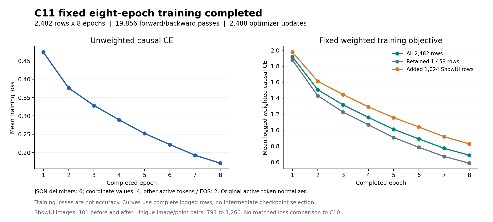
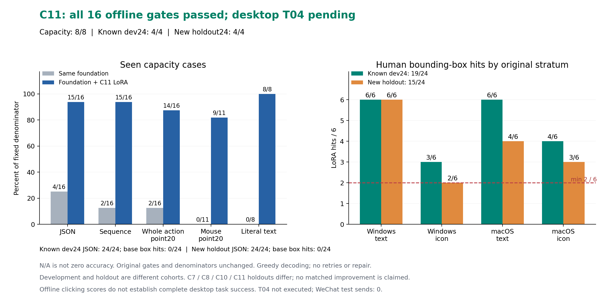
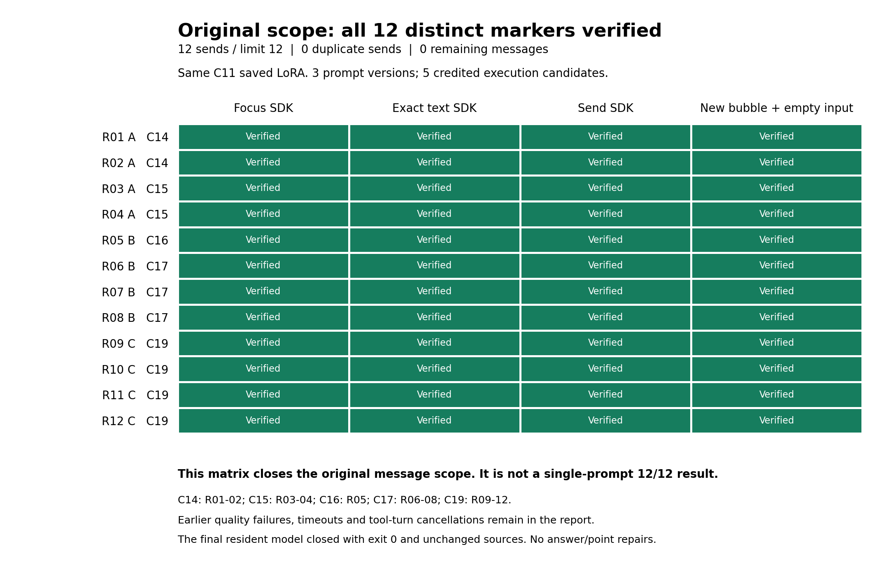

# Week5 最终报告：多模态GUI智能体训练、实机闭环与交付

日期：2026-10-17（Australia/Sydney）。Week5原任务范围已完成，未进入Week6。C11训练、保存权重审计和原16项离线门槛均通过；原授权的12条不同标记均已向「文件传输助手」发送并逐例核验，重复发送0条，剩余额度0条。

**这12条来自3版提示、5个有成功结果的执行候选。它们构成原消息范围的完整覆盖，不是某个单一候选或最终固定提示的12/12独立得分。** 历史定位、字段错误、超时及轮次中断均保留，未通过修改输出、坐标、分母或门槛补过。

## 训练与保存权重

基座为`Qwen/Qwen2.5-VL-3B-Instruct`，固定revision `66285546d2b821cf421d4f5eb2576359d3770cd3`。C11从基座新建LoRA，保留1458行并新增1024条公开ShowUI标注，共2482行；其中ShowUI为2048行。公开截图仍为101张，独立图像／控件点组合从791增至1260。没有把新增标注数量写成新增截图数量。

固定8轮，实际19856次前向与反向、19856次手工CE和processor调用、2488次优化更新，跳过0行；训练约44511秒。LoRA rank8、alpha16、dropout0.05，目标q/k/v/o投影；学习率5e-5、weight_decay0、微批1、梯度累积8、clip1、seed42、4bit加载/BF16计算。实际手工CE使用结构6、坐标4、其余活动token及EOS为2，分母仍为原shifted活动token数；旧配置中的uniform字段不替代实际campaign损失实现与审计记录。

实际保存审计013核验288个FP32 LoRA张量、3686400参数，全部有限且与训练结束快照字节匹配，配置一致；实验闭合时206个冻结公开文件及README哈希不变（本提交分支另行整理）。LoRA SHA256：`58b005e9fa13e20df15f28ca09c71c0d61c71617abfeb96d17456982a810a54b`。

## 同基座前后对照及原16项离线验收

| 阶段／原指标 | 原始基座 | C11 LoRA |
| --- | ---: | ---: |
| 已见容量：严格JSON | 4/16 | 15/16 |
| 已见容量：动作顺序 | 2/16 | 15/16 |
| 已见容量：完整动作point20 | 2/16 | 14/16 |
| 已见容量：鼠标联合point20 | 0/11 | 9/11 |
| 已见容量：文字精确复制 | 0/8 | 8/8 |
| 已知开发：合法单击JSON | 0/24 | 24/24 |
| 已知开发：人工bbox命中 | 0/24 | 19/24 |
| C11封存留出：合法单击JSON | 0/24 | 24/24 |
| C11封存留出：人工bbox命中 | 0/24 | 15/24 |

容量8项、开发4项、C11留出4项，共16项全部通过。开发分层命中为Windows文字6/6、Windows图标3/6、macOS文字6/6、macOS图标4/6；留出分层分别为6/6、2/6、4/6、3/6。Windows图标留出2/6是原最低边界，保留此限制。实际离线6次模型加载、126请求，无修补或重试，评分017、保存原文复算018及实际owner闭合。

C11留出现已暴露；后续提示开发没有把它重称新留出。C7/C8/C10/C11留出队列不同，不能据此计算跨轮配对提升。容量集为已见数据，训练损失与开发校准不能当作未见泛化准确率。

上述离线图是离线收尾时的快照，其中桌面待验文字按当时状态解释；当前桌面结果见下图。

## 实机原12条范围

使用同一C11保存权重，原A883×641、B1707×1019、C780×600布局各4条。每个focus/type/send阶段单独观察、生成、原始动作检查、一次SDK输入并立即刷新；输入区外RGB变化必须为0。原额外editable点检查和原区域始终保留，绝对120秒包含5秒稳定等待；不修改模型答案或坐标。

| 原例号／布局 | 实际完成候选 | 提示来源 | 实际核验 |
| --- | --- | --- | --- |
| 1–2／A | C14 | 文字边界提示 | 2条新精确气泡、空输入框 |
| 3–4／A | C15 | 显式type_text/text字段 | 2条新精确气泡、空输入框 |
| 5／B | C16 | 同C15提示，修复控制超时回收 | 1条新精确气泡、空输入框 |
| 6–8／B | C17 | 输入区内部定位提示 | 3条新精确气泡、空输入框 |
| 9–12／C | C19 | 同C17提示，仅恢复当前执行轮次 | 4条新精确气泡、空输入框 |

全部文字均为原授权44字符标记，没有换标记、重复发送或新增总额。实际SDK日志中的send恰好按1至12各出现一次；12份气泡证据均显示非旧气泡、无发送中状态、输入框为空。

最后C19实际1模型、12请求、360 forwards、12次SDK、4次发送，核验9–12，正常exit0且source_unchanged=true。C17/C19同一提示累计覆盖B的3例和C的4例，但属于分段执行，不能合成新的统一12例独立成绩。

## 失败诊断与修复证据

| 候选 | 实际问题与处理 | 保留的结果 |
| --- | --- | --- |
| C11 | 复制时多出句点，原精确文字检查拒绝；后续明确引用边界 | 0条发送，原失败保留 |
| C12 | 正确文字后claim出现区域外RGB变化3216；原0门槛拒绝，检查指针动画稳定过程 | 0条发送，exit1 |
| C13 | Root发送证据缺send_authorized，发送生成前异常；修正证据字段 | 0条发送，exit1；仅清理自有测试草稿 |
| C14 | type_text返回x/y字段；属于合法JSON下的动作字段错误 | 已核验1–2，第3例失败不覆盖，正常exit0 |
| C15 | 显式文字字段提示开发校准24/24；实机3–4完成；第5例原120秒到期，未处理Promise导致内核重置 | 第5例文字SDK/发送0，退出码未观测，不能补exit0或算模型质量零分 |
| C16 | 修复过期命令先分配pending Promise，3项异常及5项原CPU检查通过；第6例点击674,665映射1002,1009落在原输入区外 | 第5例完成；第6例SDK/发送0，质量失败，正常exit0 |
| C17 | 输入区位于聊天下方、附件工具栏上方的自然语言提示；24/24原区域定位开发校准通过 | 实机6–8完成；第9例focus后实际工具轮次改变，SIGTERM；正常关闭完整性未观测 |
| C18 | 环境输入再次改变工具轮次，刚ready即取消 | 1模型、0请求、0SDK、0发送；SIGTERM，不补正常退出 |
| C19 | 取得新轮次原始截图／取消能力／激活，复用C17提示和原余4条源码 | 完成9–12，正常exit0／source unchanged |

C15文字校准实际1模型、24请求、1200 forwards；C17定位校准实际1模型、24请求、480 forwards，均正常EOS、正常退出并核验源文件不变。这两组是已暴露开发输入，不是新留出。C17中断前实际1模型、10请求、293 forwards、10次SDK、3次发送；C18请求0，以上中断没有伪装成人类Esc，也没有改变持续人类授权。

每个候选的原12分母、已消耗禁用例、实际尝试、质量失败和未执行例均保留在原receipt／事件日志；本报告的12条范围覆盖不能覆盖这些失败或推出100%通用可靠性。

## GitHub交付与复核范围

本分支包含恢复的Week5源码与CPU测试、C11几何和损失实现、可移植的训练入口、历史离线评估源码、最终LoRA、三组PNG/SVG/PDF图表及公开汇总。训练环境、基座模型、训练截图、完整中间产物及带联系人信息的微信截图不进入Git。

权重字节保持与实际C11保存审计一致。公开adapter_config只把本机基座路径改成模型ID并补上固定revision；它与原配置字节不同，修改记录见[公开结果](results/summary.json)。

公开汇总从已完成实验凭据提取；本次整理仅运行CPU检查，未重新训练或重做桌面验收。私有原始receipt与截图仍保存在本地最终交付包，哈希索引见[来源记录](results/provenance.json)。没有把未公开的原始证据说成可从本仓库独立重算。原消息额度已经用尽，本提交不包含可自动发送微信消息的入口。

恢复源码包含历史候选（Qwen2-VL、pointer、spatial head等）。最终C11采用Qwen2.5-VL-3B、原生截图及resized坐标JSON，不使用这些历史head。运行方法及数据可用性见[复现说明](Reproduction.md)。
