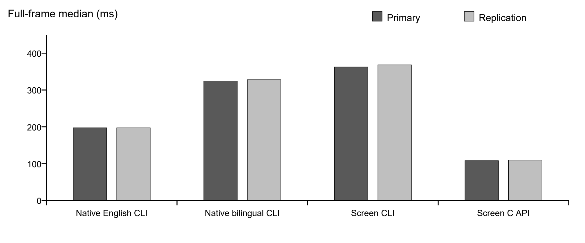

# Week 6 多模态桌面智能体实验报告
# 系统 v2.1.0  完整验收版

## 1 工作与验收范围

系统接收完整任务后，模型先提出有顺序的语义目标，再依据当前画面逐项执行。目标条件在输入前固定，任务结束时另取新画面检查用户最初的要求。本文分别报告任务分解、错误恢复、界面识别及运行监测。

同一冻结源码的正常和恢复试验均通过。正常试验有4次输入、5次规划和5次HTTP；恢复试验分别为5、6和6次。完整回归为3803项通过，pytest耗时664.89秒，pytest与Ruff退出码均为0，286份代码在测试前后、冻结记录和报告生成前相同。

8帧完全标注的合成新留出上，持久化方案的文字F1为93.6508%，两批热态整帧处理中位耗时为108.291和109.888毫秒。冷启动、一个英文标签的损失和真实单帧的速度限制另列。窗口试验只覆盖专用本地四阶段界面与两组目标，不推算任意应用成功率；Week 7的跨应用、跨分辨率综合比较不在本报告范围内。

| 要求 | 验收依据 | 结果 |
| --- | --- | --- |
| 自动分解与执行 | 模型原生有序目标、固定阶段条件及独立操作审查 | 通过受控窗口验收 |
| 错误检测与恢复 | 一次应用审阅拒绝、重新观察与预算内重规划 | 通过同源恢复验收 |
| 感知准确率与速度 | 8帧合成新留出、两批交错配对及原输出等价 | 通过预登记门槛，真实单帧限制另列 |
| 监测与日志 | 运行中父子计数、完成台账、终态和所属进程退出记录 | 通过原记录核对 |

## 2 语义任务分解与顺序执行

自然语言CLI默认采用semantic_subtasks。高层模型读取完整任务、用户最终检查条件和有限的执行反馈，提出至少两个不同且有顺序的目标。当前画面、OCR和坐标由动作规划层读取，高层分解不接收原始屏幕资料。无图像请求和视觉请求可分别指定模型，本轮两层使用同一Qwen3 VL 8B Instruct及相同digest，原始HTTP逐次记录实际身份。

每个目标保留模型原生指令、标识和完成条件。程序检查格式、重复条件和不支持的操作，不在本地补写步骤或改写模型方案。修订只安排剩余工作，可以只剩一个目标。中间条件在输入前固定，且在当次新画面中尚未成立；有已确认输入，后续两次同范围观察均满足条件，才记为完成。任务结束后另取画面检查用户最初的expect_text和forbid_text。

非末目标不能直接复用调用方全部正负终点条件的同一完整合取。已失败目标和已被拒绝的条件不能只靠更换标识重试。程序通过有限固定反馈要求模型重新生成；已执行条件保持原值，原失败不改为成功。生成提示要求各阶段明确写出所需操作，最终文字用于核对结果，不授权额外填写消息或提交说明。

文字验证仍是大小写不敏感的子串匹配，按钮名称可能被误当成完成证据。提示和格式检查也不能保证模型正确理解所有操作。因此受控验收另外对应原生目标、真实输入、前后原始画面和独立应用事件。本文保留曾达到最终画面但阶段含义不成立的失败复核，详见附录。

## 3 错误恢复与运行监测

分解、动作规划与恢复共用动作、规划、实际HTTP和时间预算，传输层隐藏重试关闭。应用拒绝、执行器异常、输入结果未知及用户取消分别记录。一次本地拒绝可能尚未发出HTTP，两项计数分别保存。输入已派发而回执不全时停止自动重放；之后看到终点也不补记该输入为及时确认。

需要恢复时，动作层先读取新画面，再规划剩余操作。文字与ID必须来自模型原回复，并与原帧及输入前刷新帧一致；可读控件必须有非空文字锚点。明确的引号名称与所选可读控件矛盾时拒绝输入。仅在原名称没有精确匹配时，对已选控件保留有限ASCII字母OCR拼写不确定性，不搜索替代目标，也不修改坐标。可选匿名候选裁图直接取自当前原始像素，默认关闭，附件清单及字节另行校验。

高层修订只收到原目标、原条件核对结果及固定错误类别，不收到画面、坐标或任意诊断文本。不支持消息内容的专用修订保留坏回复归档，在重试对话中省略该坏助手回答，模型自行生成新方案；独立检查器重建实际请求并复算拒绝类别。对于未达到的调用方最终条件，提示明确这是尚未完成的结果，不能据此增写内容或强制把状态改成ready。最终恢复试验实际走的是同一目标内的动作重试，高层失败修订另有离线检查与保存资料上的开发请求，二者分别解释。

活动子任务将累计动作和规划次数转发到顶层，已验证完成数只取外层台账。状态原子替换，事件日志追加保存；PID与创建时间共同核验进程，退出码来自所属运行器的真实等待结果。监测异常只记日志，不重放输入。监测由事件触发，较长模型请求期间仍可能显示stale，没有后台心跳保证。截图、识别、监测和桥接等待均计入墙钟时间。

## 4 界面识别优化方法

上一版的 screen 双语方案改善了中文和细边框画面的识别，但逐帧启动 Tesseract 进程仍有明显开销。本轮保留相同的像素预处理、2倍缩放、PSM 11、OEM 1、语言资源、文字合并与坐标还原，只增加显式的持久化 C API 传输方式。一个OCR实例复用已加载的语言模型，每帧重新设置图像，并清理识别结果和自适应状态，不缓存文字或坐标。

C API 实例串行使用，返回的TSV文字复制后由 `TessDeleteText` 释放，实例结束时执行 `End` 和 `Delete`。缺少库或语言资源、初始化失败和识别失败都保留为错误，没有静默切换到更快但不同的算法。原默认 subprocess 路径保持可用，新配置 `configs/week6_accuracy_persistent.yaml` 显式启用持久实例。

四个对照分别是原英文 native CLI、原英中双语 native CLI、原 screen 双语 CLI，以及 screen 双语 C API。CLI与C API使用同一份英中语言资源。开发集为4帧，新留出为另外8帧，均为完全标注的合成控制界面，覆盖明暗背景、不同字号和细边框；8帧共64个完整文字标签和48个矩形控件。旧留出标签与旧结果未修改，也没有拿旧留出错项继续调参。

2026年10月28日测量前，图像、标签、源码、配置、评分代码、OCR库和语言资源均已冻结。两批在各参与进程的CPU测试和模型调用暂停后分别运行，每帧每臂先保留一次预热，再进行10组交错配对；配置顺序按帧和重复次数轮转，奇数轮反转。两批各保存364条记录，包含每臂3次新建引擎的冷调用、8次预热和80次热调用。慢记录、测量异常和C API直接输出的诊断均保留。CLI继承原pytesseract包装器，只在非零退出时返回错误，正常退出时的非错误stderr未另行采集。

## 5 新留出上的准确率与完整帧耗时

文字按空白归一后的完整匹配和一对一IoU不低于0.5评分，未匹配输出记为误报；矩形采用一对一IoU不低于0.8。重复识别用于计时和一致性核对，准确率分母始终只计8个独立图像中的64个标签。

| 配置 | TP/FP/FN | P % | R % | F1 % |
| --- | --- | --- | --- | --- |
| native英文CLI | 40/6/24 | 86.9565 | 62.5000 | 72.7273 |
| native双语CLI | 42/14/22 | 75.0000 | 65.6250 | 70.0000 |
| screen双语CLI | 59/3/5 | 95.1613 | 92.1875 | 93.6508 |
| screen双语C API | 59/3/5 | 95.1613 | 92.1875 | 93.6508 |

screen 两条路径在两批全部182组对应观测中，文字、顺序、框、整数置信度和候选属性逐项相同。两批准确率结果也相同。候选共识别正确59个标签，误报3个，漏报5个；其中英文39/40、中文20/24。原两条 native 均识别正确全部40个英文标签，中文分别为0/24和2/24。因此总体F1提高的同时，也保留了一个英文标签的损失。

例如，Font Inspector页把 `Italic` 读成 `ltalic`，开头的大写I被识别成小写l。另一项“声音设置”的文字虽然正确，但框的IoU只有0.3862，未达到0.5，也按未匹配计入。评分同时考虑文字与位置。

矩形控件在四个配置下均检出48/48，额外候选分别为20、8、3和3。持久化路径与原 screen 的候选完全相同，没有靠丢弃控件换取速度。

| 批次 | 配置 | 中位 ms | p95 ms | 最大 ms |
| --- | --- | --- | --- | --- |
| 第一批 | native英文CLI | 197.530 | 219.378 | 240.303 |
| 第一批 | native双语CLI | 324.461 | 353.558 | 366.168 |
| 第一批 | screen双语CLI | 362.410 | 392.872 | 409.107 |
| 第一批 | screen双语C API | 108.291 | 125.664 | 132.961 |
| 复核批 | native英文CLI | 197.457 | 220.879 | 232.259 |
| 复核批 | native双语CLI | 327.970 | 359.947 | 388.581 |
| 复核批 | screen双语CLI | 368.106 | 393.713 | 402.366 |
| 复核批 | screen双语C API | 109.888 | 120.943 | 130.299 |

完整帧计时从PNG解码开始，包含像素保留检查、预处理、实际CPU OCR、文字与坐标处理，以及轮廓和候选提取。它不包含OS截屏、模型推理和动作执行。每批每臂80次热调用的中位数、最近秩p95和最大值均从全部有效记录计算，没有删除慢样本。

第一批候选相对英文 native、双语 native 和原 screen CLI 的热态中位耗时分别减少45.178%、66.624%和70.119%；复核批分别减少44.349%、66.494%和70.148%。各帧的全部配对差值另存原记录，两批均满足至少10%的总中位改善，且没有一帧的候选中位数比原 screen 慢超过5%。



冷调用包括新建引擎、加载模型和首帧处理，不包括应用CLI或YAML读取启动；OS文件缓存未受控。候选两批冷调用中位数为330.310和328.437毫秒，原英文方案为185.814和194.774毫秒，候选首帧较慢。预热记录另外保留，不能把其中的初始化成本藏进热态加速。结论限于实例稳定复用后的完整帧处理。

## 6 真实窗口上的分解与恢复

本轮使用专用的离线四阶段窗口，正常任务选择ALPHA与GREEN，恢复任务选择BETA与BLUE，并预先设置首次审阅拒绝一次。目标组合在分解前登记，独立应用事件只用于事后核对，不作为模型输入。窗口原有的400毫秒跨页防重入是实验环境条件，不计为模型能力提升。 两组均使用同一模型组合：无图像的任务分解采用qwen3-vl:8b-instruct，带图像的动作规划采用qwen3-vl:8b-instruct。两层共享预算，逐次记录实际模型名；下表列出动作模型，两个完整digest另存于冻结记录。

| 试验 | 动作模型 | 输入/规划/HTTP | 墙钟秒 | 目标尝试数 | 结果 |
| --- | --- | --- | --- | --- | --- |
| 正常 / normal_048 | qwen3-vl:8b-instruct | 4/5/5 | 385.157 | 2 | 通过 |
| 恢复 / transient_027 | qwen3-vl:8b-instruct | 5/6/6 | 366.703 | 2 | 通过 |

墙钟时间包含模型推理、桥接等待、截图、识别和日志开销。两次运行分别列出，不作正常与恢复速度的因果比较。应用层审阅拒绝与执行器失败分开统计；原动作检查、阶段条件及最终条件各自保留，任何单项通过都不能替代整项任务验收。

| 试验 | 阶段 | 原始状态 | 模型原生指令 | 独立应用事件 |
| --- | --- | --- | --- | --- |
| 正常 | 1:1:prepare_report | succeeded | Prepare a GREEN report for project ALPHA in Week6 Local Lab using visible controls. | project_selected、theme_selected |
| 正常 | 1:2:review_and_commit | succeeded | Review the prepared GREEN report for project ALPHA and commit it locally. | review_accepted、local_commit |
| 恢复 | 1:1:prepare_report | succeeded | Prepare a BLUE report for project BETA in Week6 Local Lab using visible controls. | project_selected、theme_selected |
| 恢复 | 1:2:review_and_commit | succeeded | Review the prepared BLUE report for project BETA and commit it locally. | review_rejected、review_accepted、local_commit |

阶段表保留每次尝试的原始状态；失败尝试发生过的输入和应用事件不因此改记为目标完成。

正常场景的第一目标明确要求准备ALPHA项目的GREEN报告，对应选择项目和主题两次输入；第二目标明确要求审阅并在本地提交，对应Review和Commit locally两次输入。两条原生指令、固定条件及独立应用事件一致，最终新画面显示ALPHA、GREEN和LOCAL COMPLETE。运行385.157秒，4次已确认输入、5次规划及HTTP，未知输入和执行器失败均为0。

第二步辅助检查因请求已等待38秒、超过其30秒阈值而退出1，操作端未先检查退出码便继续输入，属于操作检查疏漏。检查在报错前已核对所属进程身份，原桥接请求仍有效；原坐标、立即画面与独立事件确认选择了GREEN。该步没有通过的辅助预检查JSON，原失败记录未补写。后续身份检查、任务审计及回执审计均通过，这次偏差连同等待开销在结果中保留。

恢复场景使用全新窗口。第一目标准备BETA项目的BLUE报告，两次输入完成选择。第二目标明确要求审阅并本地提交，首次Review被应用拒绝，事件记为review_rejected。阶段条件仍未满足，动作层读取新画面后再次审阅，应用记为review_accepted，再执行Commit locally并产生local_commit。最终画面和另取的调用方终点观察均显示BETA、BLUE和LOCAL COMPLETE。

恢复场景运行366.703秒，5次已确认输入、6次规划及HTTP，未知输入和执行器失败均为0。一次应用审阅拒绝和一次审阅重试都发生在第二语义目标内；两组均只有一个高层分解轮次、两个成功目标、0个失败语义目标，不能把此例写成新的高层语义重规划。最后补充的高层失败提示没有在这次成功路径触发。

首次审阅被应用拒绝时，原动作提示性检查仍曾为passed。该原值完整保留，真实拒绝由应用事件和未满足的阶段条件确认。动作提示、语义阶段及调用方终点分别核对，单项提示通过不代表业务操作成功。double_click按一次执行器调用统计，原应用记录同样保留。

最终冻结中，运行包、配置、模型和测试文件与两组窗口试验逐字节相同。完整回归发现独立审计器未同步生产者的固定修订说明后，只修正审计器文本并重放原记录，两组均通过；新增记录标明这是只读重放，没有新桌面试验。

两组均在任务结束前实际读取顶层状态，核对累计动作、规划及已验证完成台账；结束后再核对原始画面、进程退出与应用事件。源码、配置和模型digest相同。这些结果属于Codex代理在专用窗口上的受控功能复核，不代表独立人工签字，也不推算任意桌面应用的成功率。

另使用normal001初始保存的2560×1600画面做四臂像素验证，输入始终是未裁切的整帧。该轮任务随后在语义请求阶段超时且没有输入，保存图本身不表示桌面任务成功。OCR前人工冻结中心区域的5个英文标签和2个按钮，四臂在该区域均全部识别正确。右下系统通知未完整标注，因此整帧精确率和召回率仍缺失。

| 配置 | 冷中位 ms | 热中位 ms | 热p95 ms |
| --- | --- | --- | --- |
| native英文CLI | 514.121 | 479.337 | 529.293 |
| native双语CLI | 591.602 | 597.697 | 763.812 |
| screen双语CLI | 1057.073 | 930.373 | 991.428 |
| screen双语C API | 835.531 | 589.511 | 630.930 |

这张易英文画面没有准确率增益。持久化方案比原screen CLI快36.64%，但比英文native慢22.98%；相对双语native仅约1.37%的差距，不据此断言单帧改善稳定。它保留了screen的全部有序输出，也说明合成集上的速度优势不能推及每个真实桌面画面。

## 7 测试结果与失败记录

| 范围 | 通过 | pytest秒 | 说明 |
| --- | --- | --- | --- |
| 感知定向 | 59 | 1.37 | C API寿命、异常及原OCR兼容 |
| 最终源码完整回归 | 3803 | 664.89 | pytest与Ruff实际退出码0；286份代码前后与当前相同 |

pytest所属运行器等待668.500秒，全验证运行器669.234秒。通过数来自执行后的pytest终端汇总，并与同源收集数核对；定向测试与完整回归有重叠，不相加。

开发失败、桥接中断、格式和定位拒绝保留在附录，未改记为成功，也不作为模型质量零分。历史结果只对应各自源码和模型候选，不合并计算最终成功率。

## 8 使用与结果复查

自动语义模式由 `scripts/week6_agent_cli.py --instruction` 进入，也可用 `--automatic-protocol` 显式选择。旧的滚动动作和观察边界模式仍可用于兼容对照。配置中的OCR传输方式单独指定，模型参数、任务预算与最终条件由调用方设置。

```text
python scripts/week6_agent_cli.py --instruction "Complete the local task" --automatic-protocol semantic_subtasks --expect-text "Expected final marker" --config configs/week6_accuracy_persistent.yaml --validate-only
```

当前机器使用以下语言资源目录和OCR库，不需要改全局环境变量。其他机器须在配置中填写实际安装路径，并按保存的SHA核对语言资源；本轮未重新安装运行环境。

```text
D:/week6-full-ocr/tessdata
C:/Program Files/Tesseract-OCR/libtesseract-5.dll
```

```text
python -S scripts/week6_status.py --run-dir outputs/week6/your_run_id/automatic
```

新对照、逐帧原记录和独立复核保存在以下目录。

```text
Document/Week6/results/full_requirements_20261028/
```

源码与数据按原批次保留，重新测量应登记新目录，不能覆盖本轮记录。历史使用说明、原感知数据和旧留出说明仍可分别查阅。

[本轮使用说明](https://github.com/ZhanboGong777/multimodal-desktop-gui-agent/blob/codex/week6-full-requirements/Document/Week6/README.md)

[本轮实验记录](https://github.com/ZhanboGong777/multimodal-desktop-gui-agent/tree/codex/week6-full-requirements/Document/Week6/results/full_requirements_20261028/)

[历史留出实验说明](https://github.com/ZhanboGong777/multimodal-desktop-gui-agent/blob/codex/week6-delivery/Document/Week6/results/perception_accuracy_20261024/README.md)

四项工程验收、报告页面检查和源码发布检查分别记录。报告生成依据与页图、数字、链接及分发文件的检查结果由校验清单记录。

## 附录A 开发记录与历史对照

### A.1 失败与未通过记录

| 记录 | 问题 | 已保存的结果 |
| --- | --- | --- |
| 感知pilot001 | C API TSV没有列名 | 按官方接口解析前保留失败 |
| 感知pilot003 | 小数与原包装器整数置信度不等 | 匹配原转换后冻结，未利用留出调参 |
| normal001 | 初始语义请求超时 | 1规划、1HTTP、0输入、0未知，子退出码1 |
| normal002 | 理由循环至4096输出token上限 | length截断；1规划、1HTTP、0输入、子退出码1 |
| normal003（v2） | 错误声称缺少已指定的项目 | needs_clarification；1规划、1HTTP、0输入、子退出码1 |
| normal004（v3） | 把未来审阅控件尚未出现当成缺参 | 1规划、1HTTP、0输入，子退出码1 |
| normal005（v4） | 两次画面桥接超时，缺专用窗口激活收据 | 模型调用前失败；0规划、0HTTP、0输入、子退出码1 |
| normal006（v4） | 混淆当前选项与未来状态，误称缺审阅信息 | 1规划、1HTTP、0输入、0未知、子退出码1 |
| normal007（v5） | 三个相同回复令审阅与提交重复完整条件 | 输入前拒绝；3规划、3HTTP、0输入、子退出码1 |
| normal008（v5提示修订） | 准备与审阅仍重复条件 | 输入前拒绝；3规划、3HTTP、0输入、子退出码1 |
| normal009（v6） | 激活窗口回执未在等待期内到达 | 1规划、1HTTP、0输入、子退出码1；迟到收据不追认完成 |
| normal010（v6） | GREEN文字与BLUE轮廓ID冲突 | 3输入、5规划、5HTTP、0未知；0目标完成、子退出码1 |
| normal011（v6修正前） | 三个相同回复的审阅与提交条件重复 | 输入前拒绝；3规划、3HTTP、0输入、0目标、子退出码1，93.813秒 |
| normal012（固定系统反馈v1） | 两次修正提示均传入，但三次方案仍重复同一无效条件 | 3规划、3HTTP、0输入、0未知、0目标、子退出码1，76.828秒 |
| normal013（VL7b，会话v2） | 消息角色与原文均正确传入，三次仍为相同重复条件 | 3规划、3HTTP、0输入、0未知、0目标、子退出码1，120.110秒 |
| normal014（独立VL3b候选） | 两个高层目标通过结构检查，两个动作回复为缺steps的扁平JSON | 2规划、3HTTP、0输入、0未知、0目标完成、子退出码1，82.641秒 |
| normal015（VL3b，执行格式接口修正后） | 三个TaskPlan格式合法，但ALPHA文字配了标题ID；两次重新规划仍错 | 4规划、4HTTP、0输入、0未知、0目标完成、子退出码1，169.203秒 |
| 执行接口影响范围001 | 837通过、1失败，pytest166.98秒，Ruff0 | 唯一失败为旧rolling接口断言禁止任何response_format；保留原wait1后迁移该断言 |
| full001 | 1失败、1225通过、1958设置错误 | 验证脚本漏建basetemp父目录；另缺README数量说明，原件均保留 |
| 一致性开发回归 | 283通过、2个新用例失败 | 新fixture缺窗口证据、消息形状断言错误；修正测试准备后另跑49项 |
| 监控首次窄回归 | 85通过，Ruff发现3处闭包未绑定 | 原结果保留；绑定后另跑87项通过 |
| 独立反例前两轮 | fixture或断言预期不合实际路径 | 原件与更正说明保留；第三轮26项通过，不称生产故障 |
| 统一定向001 | 16项旧T04模拟客户端分支未被新提示前缀触发 | 保留pytest退出码1和全部失败；兼容修订后的统一定向002已通过，按新批次单列 |
| 修正反馈定向001 | 1失败、351通过，pytest83.27秒 | 新用例误判HTTP额度耗尽的失败返回归档预期；仅改该用例，原33件保留 |
| 修正策略独立前两轮 | 17通过2失败、18通过1失败 | 新fixture额度与late-wrapper断言预期更正；第三轮19项通过，不计GUI失败 |

normal009已经生成三个原生目标，但在输入前的桥接等待中停止，耗时132.218秒；截图收据在运行器结束后135.102秒才到达，照存但不追认。normal010运行器耗时461.109秒，runtime为needs_clarification：应用事件依次为选择ALPHA、选择BLUE、审阅BLUE，未提交。原始动作检查因命中通用词theme而写passed，固定的Theme GREEN目标却为failed，因此没有完成记录，也未通过调用方终态。两种检查都保留，不用弱检查覆盖强条件。该次窗口关闭的wait15属于环境清理，任务子退出码仍为1。

### A.2 阶段条件与模型诊断

v5曾要求阶段条件只能从用户终态文字中选择。normal007和008中，模型没有把共享完成条件的操作合成合适目标，返回的重复条件被拒绝。这两次结果说明当时的实测方案不成立，不能推断所有请求都逻辑无解。v6撤销了终态候选池的enum与成员限制，也撤销池特有的至少两个调用方判据和单个判据200字入口限制；因此不能称所有门槛原封不动。

在normal006结束后，按预登记顺序做了三次模型开发诊断，每组只请求一次、不重试，没有新屏幕采集、输入或执行器调用。运行器等待子进程的退出码0只表示诊断脚本完成。A把相同JSON格式写成可读说明，并保留历史snapshot；模型给出6个目标，但多目标重复检查条件，被旧本地校验拒绝。B同样提供格式说明而不附当前snapshot，生成了3个结构允许的目标；其中Review和Commit只是未执行的页面文案预测，不能说明完成条件可实现。C明确缺少项目参数，模型仍给出ready并把未填写标记写进目标，缺参负对照失败。三组包装计时分别为45.250、15.047和13.438秒，共3次HTTP，均不计目标完成或GUI验收成功。B/C仍沿用了一句描述屏幕输入的v4说明，因此这些诊断也不能单独确定失败原因，或证明仅去掉snapshot就能解决问题。

normal011的独立审计重放了冻结版本的检查，三次均复现重复完成条件错误。原生ready没有变为已接受方案，未来页面文字也没有执行证明。其后引入`week6.semantic_repair_feedback.v1`，仅在可信类型的重复条件错误发生时加入固定系统说明，并精确核对请求与审计记录；本地不合并或改写目标。normal012两条修正说明各出现一次，仍重复无效方案；该运行内三份回复逐字相同，但与normal011的原文并不逐字相同，不能混称跨运行完全相同。

只读模型元数据分别请求show和tags各一次，模板包含system、user、assistant角色支持；没有生成、加载或拉取模型，也未更换资源。该记录没有提供系统提示丢失或length截断的证据，元数据本身也不能证明服务端从未截断、或模型确实理解了修正。prompt缓存统计不是回复缓存证据，不能据此解释重复方案；当时未发现专用文字模型。保存的是调用参数与返回内容，并非服务端最终渲染的prompt或原始线上请求体。

其后采用`week6.semantic_repair_feedback.v2`的有界显式会话，保留首个调用方数据包，只追加上一条至多2000字的assistant原回复与固定user修正；超长原文全部归档而不截断拼入。原要求、格式、语义门槛和预算均未改，其后normal013的实际结果另列于下文。

normal013继续使用VL7b。三次调用的消息数为2、4、4，上一条assistant原回复、固定user修正和系统级类型说明均与重建结果一致，但三份回复仍逐字相同，审阅与提交的条件重复。独立复核没有支持“角色或上下文漏传”的解释；该次未观察到有效纠正，不能追认先前运行完成。

normal014预先登记为新的模型候选，使用已安装的`qwen2.5vl:3b`同时承担语义规划和动作规划，并非专用文字模型；没有下载或训练。其265份代码与前一VL7b冻结记录逐字节相同，改变的是运行模型，不能归为同模型优化。高层首次生成准备报告、审阅并提交两个目标，结构检查允许继续；两个动作请求却返回同一扁平对象，包含action_type、target_text、arguments和status=success，而没有steps，计划解析未通过，因此没有输入。3次HTTP与2次规划分别保留，不因数量不同而改写。

normal014的独立审计确认两个高层目标合法，编译与输入前检查通过；低层两个相同回复为缺少steps的扁平JSON，由原解析器拒绝，没有窗口输入。审计原件SHA256为e00027aba65a18f946f8c5b4e3d3ec0628203d92681293cae9a149caa55f8b59，路径为review/negative_normal014_audit_001.json。审计工具本身一次异常捕获类型更正另行保留，不计为该次实验失败。

通用接口补入strict:false的TaskPlan响应格式、有限的解析错误与前次原文反馈，以及逐次原始审计。原解析器、基础系统提示、阶段门槛与预算不变。17项生产者新增用例曾通过3.65秒，之后的影响范围验证另有838项通过，不相加。normal015三次动作计划没有解析错误，实际schema参数与保存记录一致；定位仍失败，不能把这项格式观察推广为任务完成，也不追认normal014成功。

normal015三个计划都要求点击ALPHA，却选中e003（Choose a project标题），而可读ALPHA候选为e000。原规划帧与输入前检查拒绝了三次冲突，两次恢复请求均已发出但未纠正。8次激活收据属于采集准备，没有OS输入；独立事件只有started，stdout的8条Estimating resolution as 697照存。normal015结束时，后续方案尚处设计阶段；后来实施的控件绑定及有限查询另列，不据此推断唯一模型原因。

### A.3 离线回归及监控改动

| 范围 | 通过 | pytest秒 | 说明 |
| --- | --- | --- | --- |
| 感知定向 | 59 | 1.37 | C API生命周期、错误可见性及原OCR兼容 |
| 初版v6语义定向（历史） | 313 | 102.92 | 属于normal009/010使用的修改前源码 |
| 目标一致性窄回归 | 49 | 4.63 | pytest与Ruff退出码0，13份选定文件前后相同 |
| 实时监控及原监控回归 | 87 | 21.02 | pytest与Ruff退出码0，3份选定文件前后相同 |
| 目标与监控独立反例 | 26 | 8.13 | pytest与Ruff退出码0，17份选定文件前后相同 |
| 统一定向001（未通过） | 783 | 298.59 | 另16失败；pytest退出码1、Ruff退出码0 |
| 统一定向002 | 799 | 281.37 | pytest与Ruff退出码0，261份代码前后与该次冻结相同 |
| v4完整回归002（历史） | 3184 | 634.52 | 属于先前v4，不能转移到新源码 |
| v5完整回归003（历史） | 3234 | 761.44 | 属于normal007所用首版v5源码 |

v4第一次完整回归为1失败、1225通过、1958设置错误，pytest158.35秒、退出码1，Ruff退出码0，255份代码前后相同。设置错误由验证脚本没有建立新basetemp父目录引起；另一项失败是README缺少既有测试要求的数量说明。修正仅涉及目录创建与README，未放宽测试。后续v4的3184项通过、v5首版的3234项通过，以及更早的3027项通过均按各自源码保留，不能替代最终版本的同源回归。

normal010中，顶层状态曾在子任务执行三次输入期间保持actions=0，持续369.509秒。子目录虽然有逐输入记录，顶层只在子任务返回后汇总。这一缺口已补上：实际TaskRunner保存状态后，将子任务的输入计数与规划次数加上本阶段之前的累计值转发到顶层。顶层仍显示executing，细分阶段写为`child_<stage>`；子任务结束本身不增加语义完成数，完成数只来自外层验证台账。

初版v6的3262、目标与监控合流时的3328，以及修正反馈v1的3353、会话v2阶段的3380与执行接口阶段的3419均按各自收集批次保留。表中799项通过属于修正反馈前的261文件版本，不替代后续265文件会话版本或267文件执行接口版本的全套回归。首次合流的16个失败来自旧CPU模拟客户端未识别新提示前缀，修正提示兼容性后另跑通过；这不是16次窗口执行失败。

修正反馈v1首次定向为1失败、351通过、pytest83.27秒；新增测试误判HTTP额度耗尽后失败返回的归档预期，只修正该用例，生产代码未改，33件原记录保留。下一次352项通过、pytest80.45秒，另有19项独立边界通过5.73秒，均属于263文件版本，不转移为当前全套回归结果。

执行接口影响范围001的旧rolling_actions用例要求没有任何response_format，与已授权的新接口不相容。原结果为837通过、1失败、pytest166.98秒、实际wait1、Ruff0，267份代码前后相同。归档后只迁移该接口断言，要求gui_task_plan schema、strict:false、steps的maxItems=1，并明确没有高层selector请求；其他断言不变。单节点复核1项通过3.38秒，随后影响范围002为838项通过166.08秒、wait0、Ruff0，运行器177.078秒、267份代码前后同。3419仅收集，full004尚未开始。

### A.4 早期动作级验收

历史 v2.0.0 中，正常017为4个输入、4次规划、4次HTTP请求，耗时652.750秒；瞬态015为5个输入、5次规划、5次HTTP请求，耗时275.703秒。历史013受控停止、014桥接超时，以及016运行器与输入来源检查未通过等记录继续保留。它们与本轮新验收分开列示，不合并成开发成功率，也不将进程正常退出当成任务完成。

### A.5 控件候选绑定与上下文断言迁移

normal015的三次计划格式合法，却都把ALPHA文字与Choose a project标题ID配在一起。后续新增`gui_agent.target_bindings.v1`单帧候选资料，作为动作生成时的字段约束；不修改模型原生目标，不在本地选取实验室步骤，也不把绑定数据当作已执行或语义完成。

控件绑定统一001为1025通过、1失败，pytest177.31秒、实际退出码1，Ruff退出码0；270份代码以及requirements-dev.txt在该次运行前后相同。唯一失败是test_runtime_runner.py:2305的旧断言只允许8个固定上下文键，没有新增的target_bindings。它属于CPU接口预期不匹配，不是一次GUI失败，也不记为模型质量零分。

归档后仅迁移这个精确键集合断言，保留完整visible/sidebar等既有断言，并增加5项候选资料断言，逐项检查同源快照ID、原文字与ID、全部候选范围及适配器置信度阈值。单节点复核1项通过0.87秒，pytest与Ruff实际退出码0；该结果不代替统一检查或完整回归。迁移说明SHA为d842b05a6d8a2d4cd717069a47b4b48a43fa5dde54edaf1a8611d3624c02fa07。

前一草稿记录时，统一002仍在运行。该次随后完成1026项通过、pytest167.68秒、运行器181.266秒，pytest与Ruff实际退出码0，270份代码和开发依赖前后相同。3523项为当时收集数。原失败不因断言迁移或单节点复核而改记成功。

### A.6 后续定位与回执计时记录

normal016使用控件绑定版本，实际任务退出码1、运行器438.469秒，3次输入、6次规划与6次HTTP，未知输入0，完成1/2目标。项目、主题和审阅已记录，未提交。画面可见提交按钮，但该帧OCR候选缺少对应文字，两个无ID文字目标都在派发前被拒绝。鼠标是否导致漏识尚未隔离验证。

随后加入固定的文字与视觉ID选择提示及有限错误反馈，影响范围检查为1063项通过、pytest172.95秒、运行器186.641秒，272份代码前后相同。normal017仍只完成1/2目标，3次输入、6次规划与6次HTTP，运行器456.985秒、任务退出码1。两次提交查询仍缺少OCR定位；原生双击产生的两个被应用忽略的第二次物理点击照存。提示确已传入模型，但没有带来该次任务完成，也没有证据把失败归于上下文截断或鼠标。

下一版本把无ID文字目标的生成范围限制到当前完整标签和有限的词组、相邻文字组合，同时保留当前ID和匿名视觉候选。影响范围检查为1123项通过、pytest177.49秒、运行器190.906秒，274份代码及开发依赖前后相同。3620项仅收集。两次范围复核脚本遗漏导入和一次文档目录链接检查错误分别保存，修正的是检查工具，不记为模型、窗口或工程测试失败。

normal018在这一版本上完成两个目标与用户终态，独立应用状态通过；6次输入、7次规划与7次HTTP，未知输入0，运行器629.359秒。旧回执以点击API返回为结束，项目、主题和提交事件分别晚2.781、4.019和2.424毫秒。紧接着的原生新画面已观察，但未单独采样观察结束UTC，因此这些时间仍缺失，原区间没有延长。归因检查未通过，真实任务退出码1，整体结果保留为未通过，不记作模型质量零分。

该次还有两次未改变业务状态的标题点击，均照存。最终提交目标有OCR支持，不能称为已验证缺少OCR时的视觉定位能力。新登记的记录方式分别保存点击返回与立即观察结束时间，不加任意容差，不改代码、模型、输入或预算，须用新目录重新验收。其15项纯数据边界测试及合成CLI正反例只验证记录检查器，不是实机通过结果。

### A.7 输入记录补全与正反条件提示

normal019使用同一274文件版本及预登记的新记录方式，真实任务退出码0、运行器667.782秒，5次输入、6次规划与6次HTTP，未知输入0。两个目标分别对应项目与主题选择、审阅与提交；四条业务事件各自对应唯一输入，独立状态、归因、语义含义和运行中监测核对通过。窗口中仍有一次状态标题点击，没有业务作用。最后提交的模型步骤预测检查为failed，原样保留；预先确定的阶段条件与用户终态在新画面上通过。该次只验证当时版本的正常场景。

随后transient001在任何输入前停止：三次原生语义回复完全相同，把Project BETA和Theme BLUE同时写入必须出现与禁止出现的列表。具体矛盾错误与上一条原回复已在两次修正消息中送达，系统提示也有不得禁止用户终态文字的规则，因此不能把失败解释为反馈漏传。该次为3次规划、3次HTTP、0输入、未知输入0、0目标完成，真实退出码1、运行器53.343秒，尚未进入预设的审阅拒绝阶段。

后续修改只在两处固定提示中明确：expect_text要求文字在目标完成后出现，forbid_text要求目标完成后不出现，同一文字不能兼具两种要求。没有合理排除条件时可以使用空列表，合理的负向条件仍可提出。程序不在本地清空或改写列表，也没有调整解析器、校验、动作或请求预算。独立AST复核确认其余生产逻辑相同，审计代码字节未变。

新候选的影响范围检查为1127项通过、pytest273.65秒，验证运行器294.719秒，pytest与Ruff实际退出码0，275份代码及开发依赖前后相同。新增4项只验证SDK消息与原始错误保留、连续矛盾仍被拒绝、合法负向条件可保留，以及提示不含场景答案；脚本中的更正回复不能证明真实模型会遵循。3624项为当时收集数。normal019的通过仍对应旧版本，不能代替新候选的两种窗口验收或最终完整回归。

normal020仍在输入前失败。三次原生语义回复完全相同，审阅与提交各自包含正反条件重叠，准备目标还禁止了用户要求的终态文字。实际子进程退出码1、运行器57.266秒，3次规划、3次HTTP、0输入、0目标完成、未知输入0。独立检查保留失败；外层工具会话在上下文恢复后已不存在，原返回内容无法核实，因此外层退出码保留未知，没有用子进程退出码补填。检查脚本第一次因终态字段位置不同而退出1，修正的只是负向记录读取器；原成功门槛没有放宽。

下一次只把两个生成层的运行模型改为已安装的qwen2.5vl:7b。275份代码、提示、校验、调用方条件及预算均不变；1127项CPU检查据相同字节复用。模型切换前保存了完整版本和失败记录，新正常场景使用normal021与独立窗口，恢复场景另用新窗口。早期normal013虽也使用7B，但属于修改前版本且未通过，不能替代这一组合的验收。

### A.8 操作前已成立条件的拒绝与重规划

normal021使用7B模型，生成准备、审阅和提交三个目标。两次实际输入完成ALPHA与GREEN选择，准备目标验证通过；审阅目标却把Review、Project ALPHA和Theme GREEN作为完成条件。Draft ready页面上的Review report按钮已使这组文字全部成立，因此运行器在审阅输入前停止，没有给予审阅或提交完成计数。该次实际任务与外层运行器退出码均为1，经过420.938秒，2次输入、3次规划、3次HTTP，未知输入0，完成1/3目标。独立检查继续拒绝整体通过。终态记录还把额外字段放入只允许两个字段的等待结果对象，记录格式检查也未通过；原件未改写。

后续修复保留这条拒绝规则，将未执行的候选条件单独写入拒绝台账，确认输入数为0、完成资格为false。系统可以在原有分解轮次、请求数、动作数与截止时间内，再请求模型规划剩余工作。先前已验证目标继续保留，不能重放；被拒绝的原条件不变，也不会被本地换成另一个文字。反馈只带入上一条模型目标、原预测文字和固定的拒绝类别，不带入观察图片、OCR或文件路径。输入结果未知、用户取消与已执行后的失败仍按原分支处理。

新增15项离线检查覆盖原生修订、已完成目标不重放、轮次和HTTP额度耗尽、未知输入停止，以及拒绝记录被篡改为已执行或已完成等情形。首次窄检查15项通过，pytest14.22秒。随后影响范围回归1142项通过，pytest192.57秒，完整验证运行器211.500秒，pytest与Ruff实际退出码0；276份代码及配置、开发依赖在运行前后相同。两组检查有重叠，不相加。3639项仅为全套收集数，真实模型效果和最终完整回归仍须分别验证。

### A.9 剩余工作修订与模型切换

normal022实际触发了新的拒绝与重规划分支。两次输入完成ALPHA、GREEN选择，准备目标通过；审阅目标仍使用操作前已成立的文字条件，系统拒绝该候选，输入数为0，不计完成，并保留已验证的准备结果。随后模型却把自身提出的不合适条件解释为用户请求矛盾，返回需要澄清，没有继续审阅或提交。该次实际任务及外层退出码均为1，经过527.515秒，2次输入、4次规划、4次HTTP，未知输入0。独立任务检查未通过，输入记录格式检查通过；后者只说明部分输入的记录合格，不能替代任务完成。

之后仅将两个生成层的模型换为官方Ollama发布的qwen3-vl:8b-instruct，完整摘要为70e58e37beb15464e19aa903dedb2cba828b89c0fb186f75ff2738c7347b96eb。下载并校验6,190,971,795字节，实际下载进程退出码0、经过487.078秒；这一耗时不是任务推理耗时。276份代码、配置和测试文件未变，提示、校验、调用方条件与预算也不变，因此沿用同源的1142项影响范围CPU检查。未新增训练，模型权重作为独立运行依赖，不放入源码压缩包或Python wheel。新模型仍须通过正常与暂时故障场景，下载完成本身不代表验收通过。

### A.10 语义归属、失败反馈与审计修正

normal023最终画面显示Project ALPHA、Theme GREEN和LOCAL COMPLETE，实际任务与外层运行器退出码均为0，经过1441.016秒，8次输入、12次规划、12次HTTP，未知输入0。四次状态标题点击没有业务作用，原样保留；两次目标尝试仍记为failed。输入时序检查通过，严格审计退出码1，整体验收未通过。

原始画面复核发现，第二轮准备目标要求Project ALPHA和Theme GREEN，这两项在输入前已经可见，但Project ALPHA当时未被OCR识别。之后发生的业务变化是审阅成功，运行器却因此给予准备目标完成计数。单次OCR中缺少文字不能证明实际页面状态尚未成立，也不能把后续审阅归作新的准备工作。鼠标当时靠近文字，其是否导致漏识没有单独隔离验证；没有移动鼠标来改善这次结果。最后一个目标的指令只说确保可提交，实际进行了提交，目标用词也不足以清楚表达剩余操作。画面到达终点与正常退出不修复这些语义问题。

严格审计错误另定位为消息内容的字段顺序：审计器用集合遍历生成非空已完成目标的JSON，键序随进程哈希种子变化。只读诊断在0、1、2三种种子下重现失配，按原生产者的确定键序重建后，相同的消息内容检查通过。原严格审计的退出码1没有改写，这个诊断也不代表窗口试验或语义验收通过。

后续修改只补充通用的条件生成提示和失败反馈。模型应使用少量足以区分结果、有依据的条件，最后一个目标必须明确执行所剩操作。已执行目标失败时，下一轮可读取原模型目标及该目标验证器报告的缺失或不应出现的原条件文字；不带入原始屏幕文字、图像、坐标或路径。没有完整核对数据时仍为null，不补成空列表或通过。失败预测不等于用户参数缺失，失败目标不因此改记完成。审计器独立重建这些有限信息，并使用确定键序及精确的数据形状检查。

新增21项离线检查首次通过，pytest5.80秒。第一次扩大回归为1241通过、1失败，pytest209.50秒、真实退出码1、Ruff0；唯一失败是监控测试仍要求只传失败类别。仅将这一条断言改为核对原目标、原条件缺失项和固定修订提示，其他完成数、输入数、预算、图像与归档断言保持不变。第二次相关回归为1242项通过、pytest204.55秒，验证运行器218.797秒，pytest、Ruff与收集进程实际退出码均为0；277份代码及配置、开发依赖前后相同。21项与扩大回归有重叠，不相加。3660项仅为当时全套收集数，新版本的正常与暂时故障实机验收及最终完整回归仍须完成。

## 附录 A11 恢复记录读写修复

以下记录对应开发时点，待验收字样描述当时状态，最终结果以正文及最终检查记录为准。277份源码的normal024、transient002各自通过窗口与记录核对，首次预测的保存目标均仍保留为失败，没有因最终提交而改判。

其后的完整回归004实际执行3660项：3659通过、1失败，pytest606.39秒；pytest实际退出1，Ruff实际退出0，完整运行器616.235秒，源码前后相同。失败发生在恢复记录转回TaskRunResult时。运行器此前已经会附加两种固定定位提醒，但RecoveryFeedback的Literal只允许基础提示；带提醒的记录不能重新读取。这是实际数据结构问题，原来的往返断言没有删除或放宽。

修复只补齐四种原生产者文本：基础提示、基础加目标冲突提醒、基础加未定位文字提醒，以及按原顺序组合两种提醒。默认提示、模型请求、输入守卫、预算、目标条件及原检查器不变，任意追加文字仍被拒绝。新加10项检查覆盖真实恢复生产者的落盘记录、重新读取和伪造文字。修复版278份源码的355项定向检查通过，pytest103.97秒，Ruff实际退出0；3670项当时仅为收集数，需要新窗口与完整回归005。旧窗口成功不移作新版本的验收结果。

首轮修复检查有测试导入和字符串格式问题。pytest导入错误与Ruff错误原件保留；收集期间工具连接中断，所属进程随后不在，最终收集及运行器退出码未知，没有补记0。修正后另开targeted_validation_002，原目录未覆盖。此类CPU检查问题与模型任务质量分开记录。

## 附录 A12 正常场景的部分进度与输入服务超时

278份源码的normal025经过1089.750秒，实际任务和外层退出码均为0，共4次已确认输入、6次规划、6次HTTP，未知输入0。首次准备目标预测了页面上不存在的“Draft Saved”，仍记失败。第三次输入在该失败尝试中提前完成了审阅；修订目标的开始画面已显示“Review complete”，之后只执行剩余的本地提交。这里按已发生的部分进度继续，没有重放审阅，也没有把先前审阅改记为修订阶段新完成的操作。初始分解的顺序偏差和保存文字误判均保留。

首次原输入记录检查退出码1，原因是启动前窗口来源描述写成了含list_windows的更具体表述，与检查器要求的固定短语不同；严格任务检查已通过。原声明、首次拒绝和所有输入时间都未修改。之后另建只读兼容检查器，仅允许这两种明确的Sky来源描述，其他窗口、进程、开始前绑定、真实退出、事件归属和输入时间区间规则不变。原15项检查及新增3项集成检查共18项通过，兼容记录检查实际退出码0。该补充发生在试验之后，单独保留，不称原检查首次通过。Root代理核对了原始画面和实际过程；这不代表独立人工签字。

transient003未到达应用的暂时审阅故障。Root在恢复上下文期间没有及时处理第一条输入请求，原截止时间到达后，运行器记录1次未确认输入并停止后续目标。实际任务和外层退出码均为1，经过326.297秒，0次已确认输入、2次规划、2次HTTP。Root没有发出该次Sky输入，也没有补写迟到回执；运行器保留保守的未知计数。此项为操作服务超时，与模型质量和应用审阅拒绝分开记录。原目录关闭并保留后，另登记transient004，用相同278份源码、模型、调用方请求和预算重新测试。重试结果需另行核对，不能覆盖这次失败。

## 附录 A13 调用方范围与被拒绝内容的修订

transient004在开始输入前被拒绝。模型给本地提交增加了填写提交消息的要求，原消息操作守卫不允许该指令；连续三条原生回复仍保留同一句附加要求。独立复跑transient005重现这一结果，也在三次原生回复后停止。两次真实任务与外层退出码均为1，均为0次已确认输入、3次规划、3次HTTP，未知输入0。记录格式检查因没有实际输入操作而拒绝，不是一次成功的故障恢复测试。两次完整回复、验证错误及失败退出分别保留，没有继续无界重复同一候选。

后续只修改两段固定生成提示：目标应覆盖调用方所需操作，不随意增加元数据编辑、消息、通知、发布或同步；验证已拒绝模型自行附加的操作时，应修订该附加内容，而非声称错误无关并原样重提。如果不支持的操作本来就是调用方要求，仍应拒绝，不能删去调用方要求来获得通过。程序没有替模型改写目标、文字条件或操作顺序，消息守卫、执行器、时间与请求预算、调用方最终条件和原审计器均不变。

新增7项离线检查使用模拟SDK回复，覆盖附加消息操作被拒绝、只有新原生回复才可继续、重复无效回复耗尽原有次数，以及拒绝和澄清状态不被强制改为可执行。影响范围共348项通过，pytest86.59秒，验证运行器98.343秒，pytest、Ruff和收集实际退出码均为0，279份代码及配置前后相同。3677项当时仅为完整收集数；这些模拟检查不能证明真实模型修订有效。源码变更后的normal026与transient006及完整回归005需分别重新验证，之前normal025的通过不沿用。

## 附录 A14 操作前条件已成立时的固定修订提示

normal026在279份源码上未通过。实际输入依次选择ALPHA、GREEN并完成审阅；准备目标预测的保存文字没有出现，仍为失败。模型随后连续三条修订回复都要求重选已显示的项目与主题。原守卫拒绝了这些条件已成立的候选，没有重放选择，也没有提交。实际任务与外层退出码均为1，经过483.719秒，3次已确认输入、7次规划、7次HTTP，未知输入0。独立任务核对未通过，原输入时间与事件归属检查通过；后者不能代替任务完成。

下一版保留原来的完整条件判定及错误文字，只给这条守卫增加固定错误类别。只有程序实际判定第一项目标的完整条件在操作前已成立，才在下一次原生请求中加入固定修订提示，要求处理剩余工作而非重复已成立的选择。提示不包含原始屏幕资料，也不在本地编写新目标。任意错误文字不能选择高优先级提示；保存记录的检查器依据原回复和原前置状态重新计算类别，并重建完整消息。元数据版本变为v3，调用方条件、完成资格、派发和预算不变。

新增12项模拟SDK及独立记录检查，覆盖新原生回复继续、重复错误仍停止、不同错误移除旧提示、普通ValueError不能冒充固定类别、记录和前置状态被改动后拒绝、请求额度耗尽，以及原生拒绝或澄清不被强制改为可执行。首次离线检查358通过、2失败，pytest92.96秒，Ruff失败；两项失败来自新测试把材料放在检查器所允许的run目录之外。修正测试布局而保留原路径隔离后，360项通过，pytest96.79秒，仍有一处测试导入格式不符。两次失败记录均保留，不当作模型失败。

最终影响范围验证360项通过，pytest109.41秒，完整运行器122.500秒，pytest、Ruff与收集实际退出码均为0，280份代码及配置前后相同。3689项当时仍为完整收集数，不能称全套通过。新版本需重新完成normal027与transient006，再执行完整回归005；先前版本的成功不转移到这个版本。

## 附录 A15 正常路径中的规划错误与截图超时

normal027在280份源码上实际失败，任务与外层退出码均为1，经过792.140秒。共记录5次已确认输入、8次实际规划与HTTP调用，未知输入0。准备目标通过，但模型给审阅目标同时设置了审阅完成和最终提交文字。第4次输入在审阅目标下执行了本地提交，第5次输入点击终点文字，没有新的业务变化。终点画面不能证明这组语义目标均已完成，本次不予通过。

此后两个截图请求未能在原时限内获得操作端响应，原请求和缺失回执均保留，没有补填。这个操作端超时与前面的模型规划错误分别记录。原运行器又报告监控结束状态保存失败：恢复流程先公布下一次规划序号，截图失败后没有真正调用模型，结束时写回较小序号，触发了监控的计数不得回退检查。两项离线故障注入分别使用TimeoutError与OSError，均复现这一错误，2项失败，pytest经过4.40秒。它们用于定位监控问题，不属于新的实机成功记录。

## 附录 A16 监控结束记录修复与推理版模型

监控修复保留已经公布的恢复规划序号，同时在结束时写入实际调用数与该序号的较大值。尚未发生的模型调用不会补进业务台账。这样，截图失败仍能留下可信的失败结束状态；任务在分解阶段就失败时，也不会漏掉实际发生的调用。除初始化这项临时计数及结束时的写回外，生产代码的其他语法结构均与前版一致，没有修改目标、完成条件、动作派发、提示或预算。

第一轮影响范围检查362项通过，pytest100.91秒，完整运行器113.422秒。补充分解失败路径后，最终363项通过，pytest102.61秒，完整运行器115.141秒，pytest、Ruff和测试收集实际退出码均为0。新增的3项故障路径检查已包含在363项中，不能再相加。281份代码及配置前后相同；3692项此时仍只是完整收集数。

下一次实机验证把两层模型同时换为本地Qwen3-VL8B推理版，目标生成方式、原输入检查和预算不变。模型下载实际退出码为0，经过523.203秒，安装后核对完整digest。下载本身没有进行推理或训练，也不计作验收成功。旧指令版模型上的成功、失败及操作端超时均保留，新版必须重新通过正常与恢复两组场景。为避免在实机验收后才发现回归问题，完整回归005安排在这次源码冻结之后、实机验收之前；两项验收都必须对应同一份冻结字节。

## 附录 A17 输出上限失败与模型替换

normal028使用推理版模型，在桌面输入前停止。实际任务与外层退出码均为1，经过540.454秒，1次规划、1次HTTP、0次已确认输入、0次未知输入。原始HTTP响应为200，finish_reason为length：4,096个生成token均未形成最终JSON，记录中有17,855字的思考内容，最终内容长度为0。运行器没有把空回复当作可执行计划。监控此次正常保存了failed结束状态及1次规划，没有再出现结束记录的计数回退错误。

另做一次接口诊断，复用保存的任务消息和格式约束，只显式加入reasoning_effort=none。它没有截图或桌面输入，也不计任务验收。实际经过502.734秒，HTTP200，仍在4,096个生成token处以length结束，只有18,754字的思考内容，最终内容仍为空。诊断没有证明当前服务上的这一模型能按该设置关闭思考，因此没有据此新增生产接口功能，也没有改写任何原失败记录。

随后将两层运行模型换为官方Gemma 3 4B候选，安装后核对完整digest。下载进程实际退出码为0，经过299.343秒。281份代码、配置和测试文件未变，原提示、调用方条件、输入检查、完成判定及预算也未变，沿用同源的363项影响范围检查。此前完整回归005实际3,692项通过，pytest638.12秒，pytest和Ruff实际退出码均为0；其测试时README原字节单独保存。新模型仍需通过正常与恢复场景，再按新冻结文档字节完成回归006，不能把旧模型上的结果转移为新模型成功。

## 附录 A18 拆解指令与实际完成的区别

normal029使用Gemma 3 4B同时分解任务和规划动作。任务最初拆为准备、审阅和本地提交三个目标，实际前两次双击落在静态文字上，第三次才选中ALPHA，没有完成GREEN准备。原任务与外层退出码均为1，经过315.969秒，3次已确认输入、6次规划、6次HTTP、未知输入0。后续修订也未通过原格式检查。本次按失败保留。

随后增加显式文字模型参数，允许无图像的任务分解和带图像的动作规划分别选模型；两者仍使用同一组动作、规划、HTTP和时限预算。模型选择只依据请求是否实际带图像，不依据任务文字。记录检查器核对原请求和原响应中实际使用的模型名。配置与感知源码保持原样，未重做感知训练或标定。

该版本以Gemma 3 4B分解、Qwen3 VL 8B Instruct操作。normal030经过325.781秒，4次已确认输入、5次规划、5次HTTP，三个模型目标与应用的项目选择、主题选择、审阅及本地提交事件对应，原退出、记录检查和语义复核均通过。

同版本的transient006经过311.610秒，5次已确认输入、6次规划、6次HTTP，未知输入0。应用确实先拒绝一次审阅；模型重新观察并点击下移后的按钮，审阅成功，随后完成本地提交。原任务、外层运行器和两项记录检查均正常退出。然而第二个原生目标只要求“审阅并确认准确性”，完成条件却是“LOCAL COMPLETE”，实际还执行了独立的本地提交。语义复核因此未通过，不能把运行器的succeeded直接当作完整验收，也不能事后给原目标补写提交操作。

针对这一问题，先保存原始提示和失败回复，再做仅用已存任务消息的生成诊断。这些诊断没有新截图或桌面输入，不计实机验收。小模型仍出现遗漏操作、重复最终条件或臆测页面状态；另一个模型提出澄清时也按原结果保留。随后将累积提示整理为554词，要求模型先只读各阶段的操作描述，核对是否完整覆盖用户要求，再核对条件是否需要额外未写明的动作。变更仅涉及生成提示常量，原验证、执行和预算代码不变。

整理时的相关检查曾出现692项通过、2项失败，指出原有的最少条件和后续控件隐藏说明被遗漏；这些约束已补回，原测试未修改。最终同源694项通过，pytest 117.50秒，pytest与Ruff实际退出码均为0，3,715项仅完成收集。更早的小范围检查还发生过临时目录准备异常，另列在原始日志中，未当作模型或任务退出。

新候选的两层均显式采用已安装的Qwen3 VL 8B Instruct，完整digest另存。保存消息诊断返回了明确的准备与审阅、本地提交目标；其中未来页面文字仍是未经观察的预测。登记时要求新正常与恢复场景、当前完整回归及报告页面检查分别通过；正式结果见正文，不沿用normal030的旧版本成功。

### A19. normal_031 的输入等待超时

normal_031 的任务进程实际退出码为1，运行447.641秒。原始运行记录为2次已确认输入、1次未确认输入尝试、4次规划及4次HTTP调用，最终状态为failed。第三次点击请求在会话恢复期间超过等待时限；操作者恢复后未先检查进程退出记录，仍执行了点击。该点击发生于任务进程退出之后，界面随后显示Review complete，但这不属于本次运行中的成功操作，不能计入任务完成数。本地提交没有执行。

原始失败状态、计数及两个未通过的审计均保留。初始准备目标预测了Saved Locally，这一条件从未验证通过，也没有用后来的画面补记成功。后续使用同一冻结源码、模型及预算在全新窗口中进行验收；输入前另查实际进程身份、任务退出记录和待处理请求时限。该检查只约束实验操作，不修改目标、条件、运行日志或系统完成判定。

### A20. normal_032 的阶段操作与完成条件不一致

normal_032 的任务进程和外层运行器实际退出码均为0，运行371.265秒。实际执行4次输入，使用6次规划及6次HTTP调用，没有未确认输入。独立应用事件依次记录项目选择、主题选择、审核通过和本地提交，最终画面显示ALPHA、GREEN及LOCAL COMPLETE；两项保存记录检查也通过。

该运行仍未通过逐阶段语义验收。初始准备目标预测Saved Locally，条件未出现，原目标按失败保留。模型随后把剩余目标写为“审核报告并确保审核在本地完成”，却以LOCAL COMPLETE为条件。执行前画面已经显示Review complete，该阶段唯一输入是Commit locally。因此，实际提交操作没有在原生目标指令中明确写出，不能把提交造成的终点状态当成审核目标的成功证据。目标标识中带有commit，也不能代替指令正文缺失的操作。

后续修改仅涉及分解提示：要求各阶段保留用户请求的操作动词，最终持久化不提前放进准备目标；中间检查优先采用足以区分状态的已有最终条件子集，新增预测文字须有必要。其余282份源码及所有执行、验证、预算和完成计数逻辑不变。修改后的694项相关测试通过，pytest148.08秒、所属运行器161.187秒，pytest、Ruff和收集命令实际退出码均为0；3715项仅完成收集，尚不能写成完整回归通过。两组保留任务的离线生成均明确列出准备、审核和提交，仍包含未经界面证实的Report Generated预测，因此不能据此宣称实机通过。


### A21 失败方案的有界修订

normal_033 在前一版源码上完成了实际流程，任务和外层运行器均正常退出，运行511.797秒。实际执行4次输入，使用7次规划和7次HTTP调用，未确认输入0。最初准备目标预测的Report Generated没有出现，因此该目标保留失败。新目标明确写出审阅与本地提交，程序没有把原失败改为成功；两项记录检查及逐阶段复核通过。这是前版结果，不转移为修改后源码的验收。

同版transient_007运行396.953秒后停止，任务与外层退出码均为1。实际执行3次输入，使用5次规划和5次HTTP调用，未确认输入0。应用在第三次输入时拒绝审阅，显示Review unavailable。下一轮模型原样重复了先前失败的准备目标，程序在再次派发前拦截。没有发生第二次审阅或本地提交，本次保留为blocked。

修复把相同失败目标的检查提前到原有有界生成修正流程中。输入前条件已经成立的原拒绝仍优先处理；旧的外层重复方案检查也保留。初次相关回归出现705项通过、1项失败，原因是新检查改变了既有拒绝的状态分类，已恢复原分类，没有修改该测试的原断言。更早的新测试夹具有2项设置错误，原文件和失败输出同样保留。

仅用保存消息的诊断显示，重复拦截本身不能让小模型正确恢复。模型仍会重述失败方案、提出不必要的澄清，或让审阅目标依赖未写明的提交操作。不同文本模型、固定提示和消息历史诊断均保存原回复，没有进行桌面输入，也不计实机验收。最终补充反馈只传递原期望文字中已被同一次验证匹配的部分；缺少完整核对结果时仍为null。匹配文字不增加操作或目标完成计数。模型据此生成剩余目标，程序不在本地补写步骤或替换条件。

开发中的一轮708项回归全部通过，pytest185.66秒，但Ruff指出新测试文件的导入顺序错误；因此该轮整体验证仍按未通过保存。排序修正后，93项相关检查、Ruff和收集命令均正常退出。补充匹配反馈及其负例后，当前同源202项检查通过，pytest72.60秒，Ruff和收集命令退出码均为0。3738项此时只完成收集，不能据此写成完整回归通过。完整回归和新实机结果分别列于正文。


### A22 同源复核与输入描述矛盾

normal_034在284文件版本上完成正常流程，实际运行495.047秒，任务与外层运行器均退出0。已确认输入4次，规划6次、HTTP调用6次，未确认输入0。最初准备目标预测的Report Generated未出现，仍记为失败；后续新目标明确包含审阅和本地提交，执行器只提交已经审阅的报告，没有重新选择项目或主题。独立记录检查和原始画面复核通过。这项结果属于该冻结版本；后续源码改变后需要重新验收。

transient_008实际进行了BETA、BLUE选择、首次审阅被拒绝、重新审阅和本地提交，共5次已确认输入。提交后的即时画面显示LOCAL COMPLETE，但最后两次截图请求在代理上下文衔接时未得到服务。任务最终核对结果为inconclusive，实际子进程与外层退出码均为1，因此本次没有通过。原截图请求保留缺失，没有事后补拍或补造回执。模型还预测了Commit Successful文字，即时画面没有该文字，但本轮正式核对因截图中断，不能把这一预测直接记成已经完成的文字验证。第四次输入曾因操作端响应延迟超过30秒提示阈值，经核实同一进程、原请求、当前画面和原180秒等待窗口后才执行；延迟包含在总经过时间中。

同一源码的独立复核transient_009暴露另一问题。模型步骤描述写着选择BETA，target_text和元素ID却共同指向ALPHA。现有文字与ID一致性检查没有发现描述中的矛盾，实际选中了ALPHA。后续两次点击项目标题没有恢复选择，之后进入错误项目的BLUE草稿并触发审阅拒绝。代理没有替模型点击BETA，也没有把错误项目换算为成功。确认界面没有返回选择入口后，为修复已定位问题而受控结束本轮。终止前核验了实际CPython的PID、创建时间、命令与父进程；子进程真实wait为15，外层工具退出为1，两者分别保存。最终任务结果缺失，不能称为自然退出或完整验收。停止时尚未服务的截图请求同样保留。

修复只检查一种明确语法：步骤以点击、选择等动作开头，并立即用引号写出目标名称。如果原目标对应的可读文字证据与该名称相矛盾，输入前拒绝，交由原有预算内的模型重新规划；程序不挑选替代控件。未加引号、较复杂的描述以及缺少可读证据的视觉目标仍走既有路径，因此该检查不能宣称解决所有自然语言歧义。新增19项离线检查通过，pytest3.52秒，随后Ruff正常退出。有关回归、实机验证和完整测试的最终结果分别列于正文，不与这些开发检查相加。


### A23 引号目标检查中的OCR不确定性

normal_035在引号目标检查的285文件版本上完成实际流程，任务、外层运行器和两项记录检查均退出0。实际运行455.578秒，4次已确认输入、6次规划、6次HTTP调用，未知输入0。原始保存画面及逐阶段复核通过。最初Report Generated预测仍未通过，后续由新目标完成本地提交，原失败没有改为成功。

同版transient_010在242.531秒后失败退出，任务与外层退出码均为1。三次动作回复均在描述中写BETA，实际目标字段采用OCR的BELA。保存画面显示同一位置实际为BETA按钮，但严格引号检查拒绝这三次回复，整轮已确认输入为0，顶层规划计数为4。没有产生审阅拒绝、恢复重试或本地提交，不能算作故障恢复验收。原始文字、模型回复和拒绝记录均保留。

随后尝试在既有固定一致性反馈中补充“引号名称应与所选OCR一致”等提醒。31项开发检查及Ruff通过，进一步436项检查通过，pytest108.88秒，3759项只完成收集。保存请求的单次原生诊断使用原截图、原任务和同一模型，只更换生产者生成的固定反馈文字；仍返回BETA描述与BELA目标，原检查继续拒绝。该诊断没有桌面输入，不计实机验收。四项提示修改及全部记录单独保存，代码恢复到此前版本，没有将无效提示留在最终候选中。

最终收窄的是“能够证明矛盾”的边界。引号名称在画面中存在明确匹配，而模型指向另一个控件时，继续拒绝。若该名称没有任何可读匹配，仅与已经选定的OCR文字相差一次字符编辑，且为4至160字符的ASCII字母名称，则只认为OCR拼写不确定，继续由原文字、ID和刷新画面检查决定。短名称和数字名称没有这一处理。程序不搜索替代目标、不修改OCR或坐标，也不据此判定任务完成；相近拼写同样可能代表不同含义，这仍是本检查的限制。

保存记录的对照表明，原BETA描述指向ALPHA的回复仍被拒绝；BELA回复则保持原元素ID和1281、1048坐标，不再仅因这一个字符差异拒绝。代理实际查看了两张原始画面，这只是只读反例核对，不等于新实机运行成功。新增边界检查后，28项开发测试通过，pytest3.48秒；完整的相关回归496项通过，pytest135.72秒，Ruff及收集命令退出0。3766项此时只完成收集，完整回归与之后的实际场景分别记录，不相加。


### A24 目标矛盾的恢复反馈与后续失败

normal_036实际退出1，运行129.266秒，尚未派发输入。第一次任务分解后的一条窗口捕获请求未收到回执，程序记录dedicated-window activation receipt missing。原请求和缺失状态均保留，结束后没有补写回执或继续操作。两项保存记录检查均退出1，这次失败不归为模型质量成功或训练异常。

同源独立normal_037运行370.515秒后退出1，实际3次输入、8次规划、8次HTTP调用。项目ALPHA、主题GREEN和审阅已完成，但原准备目标预测的Report Generated未出现；新目标仍要求不存在的Generate Report控件，未完成本地提交。严格任务检查退出1，输入回执协议检查退出0。这里区分了操作记录完整与业务任务完成，失败目标未改判。

同源transient_011运行160.359秒后退出1，已确认输入0。三次原生回复均描述选择BETA，实际目标字段与元素ID却指向ALPHA，输入前检查逐次拒绝。没有实际审阅拒绝、重试或提交，不能算作恢复验收。相关回执与失败记录保存后，测试窗口才按进程身份核验关闭。

该轮显示，引号冲突虽被拒绝，恢复反馈却只保留了普通目标解析失败的信息。后续候选把该错误归入已有的固定一致性反馈，说明引号名称应与所选控件当前OCR一致；目标必须由模型重新选择。反馈使用有限固定文本，不传入未受约束的原始错误字符串，不改写目标ID、文字或坐标。先前单独提示的原生诊断仍按失败保留，此次是与OCR不确定性边界组合后的新候选，须重新进行实际场景验证。

组合检查覆盖13份测试文件，实际606项通过，pytest 143.58秒，Ruff和收集命令实际退出0；3768项此时只完成收集。这些相关检查与之后完整回归重叠，不相加。新候选保留285份源码、配置和测试，四项变化仅为恢复反馈及其固定文本校验。原目标拒绝、操作前后画面检查、预算和完成条件继续生效。


### A25 长控件名称的OCR拼写边界

组合候选上的transient_012在69.406秒后退出1，实际3次规划、3次HTTP调用、输入0。原生回复在本地提交指令中额外要求“提交消息包含LOCAL COMPLETE”，三次模式校验均被现有消息守卫拒绝。没有执行桌面目标。这是模型增加未请求内容后的规划失败；原回复及校验错误保留，未放宽消息守卫。

同源normal_038运行351.765秒，3次输入、8次规划、8次HTTP调用，任务和外层退出码均为1。实际完成了ALPHA、GREEN和审阅，未完成本地提交。修订指令已明确要求审阅及本地提交，但三次动作描述均写Commit locally，而目标采用当时OCR的Commiyocally。保存画面显示该目标位置确为提交按钮；原来的单字符容差仍拒绝，固定反馈也未使模型更换引号拼写。原失败保留，严格任务检查退出1，输入回执协议检查退出0。

后续修改只调整已选控件上的拼写不确定性。4至9个ASCII字母仍最多允许一次字符编辑；双方去空白后的字母长度均至少10时，最多允许两次插入、删除或替换。只有空白差异也不用于证明冲突。画面若存在另一个精确同名的可读控件，仍拒绝当前错误目标。程序不寻找替代控件、不改写OCR、元素ID或坐标，短名称和数字名称没有新增容差。相近名称可能代表不同业务含义，仍需原定位检查和实际任务条件核对。

保存记录对照中，BETA描述指向ALPHA仍以原错误拒绝；Commiyocally则保持原控件ID及1281、1053坐标。代理实际查看两张原始保存画面，此项只读复核不产生实际输入，也不计成功。原28项引号测试全部保留，另加8项检查，覆盖长名称、空白差异、短名称的过量差异、数字及精确竞争控件。相关回归实际614项通过，pytest 142.70秒，Ruff和收集命令退出0；3776项此时只完成收集，最终完整回归另列。

此前登记的transient_013尚未启动，没有结果或退出码。新增实际验证从新窗口开展，既有成功记录不跨源码版本使用，既有失败亦不改判。


## 附录 A26 后续规划失败与条件文字边界

上一源码的normal_039实际运行350.297秒，4次已确认输入、6次规划和6次HTTP调用，任务及外层均退出0，两类审计均通过。原准备目标猜测Report Generated，条件未通过，仍保留failed；后续明确要求审阅并本地提交的修订目标通过。此次结果保留在对应源码下，不转用于后续修改版本。

transient_014在首个实际操作前因一条窗口截图回执缺失而退出1，运行130.344秒，0次输入、1次规划及HTTP。缺失发生在操作端上下文切换期间，未补写回执；任务检查及回执检查均退出1。transient_015运行71.765秒，transient_016运行70.328秒，两次均0输入、3次规划及HTTP、任务和外层退出1。模型连续提出把LOCAL COMPLETE写入提交说明，超出调用方要求，被原消息守卫拒绝。原回复保持不变。transient_015的窗口声明另缺两个字段，首次只读审计因此报错；随后只作失败记录复核，未补写原声明，也未获得通过结论。

后续只补充通用规划提示：调用方最终文字条件是待核对的可见证据，不是要写入字段的内容；本地保存或提交本身不要求另写消息、标题或说明。原消息守卫、目标条件、原生计划解析、输入和预算均不变。相关检查616项通过，pytest用时143.70秒，Ruff及收集退出0；3778项此时只完成收集。另两项边界测试保留不支持消息的拒绝，并要求由新原生回复移除附加操作后才能执行。该离线结果不等于桌面验证。


## 附录 A27 终点成功与阶段含义的分别复核

transient_017实际运行331.141秒，5次已确认输入、6次规划和6次HTTP，任务及外层退出0，两类机器审计也退出0。应用先拒绝审阅，之后真实重试并完成本地提交。原生计划却把“选择项目、主题，然后启动审阅”写入第一目标，第一目标只执行选择便因可见的Review按钮文字获得succeeded；实际审阅及重试发生在下一条“审阅后提交”的目标内。代理在结束后实际查看初始、第二目标前及最终原始画面，并对照独立应用事件，因此未批准完整语义验收。机器通过、原阶段状态及物理终点均照实保留，没有把原日志改为failed或将此例当完整通过。

随后同源transient_018实际运行94.031秒，0次输入、3次规划和3次HTTP，任务及外层退出1，两类机器审计退出1。三次计划继续添加“提交说明包含LOCAL COMPLETE”，被原守卫拒绝。提示虽要求不要增写内容，错误仍只写禁止发送消息，模型的修订理由称已去掉发送消息，却重复本地内容编辑。这是可重复观察到的规划修订失败。

下一次修改仅补充原拒绝错误的说明：同一守卫也拒绝编写本地提交说明，验证文字不代表内容编辑请求。正则、分支、接受或拒绝范围均不变；旧错误前缀保留。原有拒绝测试增加一条断言，检查说明能传到规划修订上下文。修改前285份文件全部保留，相关回归当时仍在运行；实际通过数及新版本桌面结果由后文完成记录给出。此前保留但未启动的normal_040没有结果或退出码。


## 附录 A28 不支持内容的专用修订路径

补清原拒绝说明后，transient_019仍在三次原生计划中重复附加本地提交说明，实际运行92.922秒、0次输入、3次规划及HTTP，任务和外层退出1，任务及回执审计退出1。原错误说明和回复完整保留，未据此放宽消息限制。

后续修订为单独的有限反馈分支。原消息守卫使用私有ValueError子类标记，正则、分支和拒绝内容范围均未改变。只有Pydantic校验中保存的真实守卫异常类型能够触发该分支，回复文字或伪造同名错误不能触发。此时坏回复仍完整归档，但不作为上一条助手回答回送；原调用方请求及有限错误上下文保留，模型须自行返回全新计划。遇到另一类错误时移除本提示，其他修订历史保持原规则。修订策略标记更新为v5，初始规划提示和输入、目标条件、共享预算均未改变。

独立审计重新解析原回复，复算异常类别并核对完整线上请求；测试还人为插回已省略的坏助手回复，确认审计拒绝。另测普通ValueError不能冒充此类别，以及后续格式错误会移除旧提示。原非ready结果和耗尽预算后的零输入停止仍保持。第一批检查发现三处导入排序问题，已停止其唯一所属pytest并保留实际退出15及未通过记录；修正后重新运行完整相关批次，651项通过、pytest用时155.03秒，Ruff和收集退出0。3781项此时只完成收集，新版本的实际桌面验收及完整回归另行记录。该私有检查中断不计桌面模型任务失败。

normal_040、normal_041和transient_013仅登记而未启动，均没有退出码或结果，不计为失败次数。


## 附录 A29 完整终点条件的阶段顺序检查

transient_020运行162.031秒，0次输入、2次规划及HTTP，任务和外层退出1，任务及回执检查退出1。v5专用修订使第二条原生回复去掉了附加消息内容，但该回复把BETA、BLUE和LOCAL COMPLETE完整终点条件用于中间的审阅目标，后面另有提交目标。操作端评估计划期间有一条原始截图回执未及时返回，子任务因此blocked。该回执仍为缺失。事后尝试先核验进程身份再停止时，原进程已不存在，未执行停止操作。此例既不是完整语义通过，也不能把实际退出原因改称模型主动拒绝。

新增检查只比较调用方全部正、负文字条件的完整合取；忽略顺序并按原验证口径casefold后，若某个非末目标使用完全相同的条件，且后面还有目标，则在输入前拒绝。继续使用原条件重复错误及固定修订反馈，由模型自行给出新的中间结果或把尚未完成的必要操作明确归入最后目标。没有固定阶段词表、按钮名称、样本专用条件数量，也没有程序代写计划。

该规则只覆盖完整合取相同的情况。条件子集、额外条件或指令的实际业务含义仍需结合原始画面及应用事件复核，不能据此声称识别全部语义错误。只读重放transient_020的保存计划时，新规则在读取任何执行前画面之前拒绝，原编译记录保持不变；重放不计桌面成功。相关回归655项通过，pytest用时156.93秒，Ruff与收集退出0；3785项此时只完成收集。新源码的实际验收和完整回归结果另外记录。normal_042仅登记未启动，没有结果或退出码。


## 附录 A30 保存画面的定位诊断

transient_021在完整终点条件检查版本下运行165.469秒，0次输入、4次规划及HTTP，实际退出1。模型把BETA名称与ALPHA控件ID配在一起，原定位检查拒绝。normal_043仅登记未启动，没有退出码。

后续诊断只使用该次保存画面，不派发桌面输入。另一视觉模型和无schema请求仍把文字配到其他控件；有效的通用定位提示也没有纠正。两次早期提示试验覆盖了未被生产调用的方法，实际线上请求没有变化，已经单独更正，不能引用为有效提示干预。裁图与简化ID的一次组合返回正确BETA候选，但只是开发诊断。原图、原回复、失败和更正记录均保留。

## 附录 A31 图形候选与原生文字锚点

新增可选图形候选细节：在原完整画面之后附上当前匿名且无OCR文字的全部合格轮廓裁图，按阅读顺序提供ID和边界。最小尺寸96×24，最多8张，总面积不超过100万像素；裁图来自原始像素，不补写文字，也不按目标挑选。默认关闭。客户端核对清单、字节和哈希，附图仍在同一HTTP内。相关回归819项通过，pytest173.21秒，Ruff退出0；3799项当时只完成收集。原冻结表实际286份文件，早期标量285和登记表中的旧审计器哈希已通过独立勘误说明，原记录未覆盖。

该版本transient_022运行330.922秒，5次输入、7次规划及HTTP，真实拒绝一次审阅后完成修订和提交；任务、审计和语义复核通过，只对应当时版本。窗口声明原完整预检查存在，但首次复制用了另一文件名；正确副本在任务结束后补入，复制时间已披露。normal_044运行155.281秒，0次输入、4次规划及HTTP，实际退出1：原生回复只有ID而缺文字，刷新后旧ID不再对应原控件，输入被拒绝。

下一修改要求紧凑定位格式保留当前规范ID；可读控件必须在原生target_text中给出非空文字，只有当时确无OCR的匿名候选可省略。运行层不补写文字或替换ID。新增边界与刷新重定位测试后，823项通过、pytest172.30秒，Ruff退出0；3803项当时只完成收集。保存画面上的两次模型请求不计实机验收。

## 附录 A32 操作服务与目标语义复核

normal_045运行503.218秒，3次已确认、1次未确认输入，5次规划及HTTP，实际退出1。第四次输入已发生，但操作端在上下文切换后才提交回执，超过原任务等待期；终点可见也不能把迟交回执补为及时成功。transient_023运行354.265秒，3次输入、8次规划及HTTP，实际退出1；准备目标完成，审阅拒绝后修订仍未能提出可执行步骤。

同版本normal_046运行292.093秒，4次输入、5次规划及HTTP，任务与两类审计退出0，原生阶段和独立事件一致。transient_024运行359.594秒，5次输入、6次规划及HTTP，机器检查和最终提交均通过，但第一目标写明还要启动审阅，实际只选择项目、主题便被可见Review按钮误计为完成。结束后的原始画面与事件复核因此不批准完整语义验收。原succeeded字段保持原状，未改写日志。

## 附录 A33 目标描述与失败修订说明

后续只在通用生成提示中要求每条目标的文字描述足以覆盖其条件所需操作，不用较晚目标的操作替较早目标完成。相关823项通过、pytest174.26秒，Ruff退出0；3803项仍只是收集数。一次文字模型开发请求产生准备和审阅提交两个目标，不计桌面通过。

该版本transient_025运行274.844秒，1次已确认输入后有两条截图请求未收到原始回执，任务退出1；缺失未补填。normal_047运行303.782秒，4次输入、5次规划及HTTP，两个目标及独立事件一致，任务与审计均退出0。transient_026运行290.984秒，3次输入；准备完成，首次审阅被拒绝。第二轮原生分解错误地把尚未达到的调用方LOCAL COMPLETE条件当成额外要求，返回needs_clarification，实际退出1。

最后一次修改只补充原固定失败修订提示：调用方不变的最终文字未出现，表示请求尚未完成，不是模型自行猜测的标题，也不是缺少用户参数。调用方已允许重试时，可提出剩余工作；原拒绝、条件和预算不变。823项相关检查通过，pytest183.09秒，Ruff退出0；3803项完整回归另以最终实际运行结果为准。对transient_026原失败资料的一次文字请求返回审阅并提交的ready方案，但不计实机恢复证明。

## 附录 A34 最终同版本场景与操作偏差

最终源码的transient_027运行366.703秒，5次已确认输入、6次规划及HTTP；normal_048运行385.157秒，4次已确认输入、5次规划及HTTP。任务和两类审计均实际退出0，未知输入与执行器失败均为0。两组各一个语义分解轮次、两个成功目标，没有失败语义目标。恢复场景的一次应用审阅拒绝及重新观察后的重试都发生在第二目标内，不是新的高层语义修订。最后新增的高层失败提示在该成功路径没有被触发。

normal_048第二步的辅助时效检查实际退出1，原因是原请求已等待38秒，超过该辅助检查30秒阈值。操作端未先检查退出码便继续输入，这是一次操作检查疏漏。该检查在报错前已核对所属进程身份；原输入请求仍在原桥接等待期内，立即画面、原坐标、回执和事件确认选中了GREEN。该步未生成通过的辅助预检查JSON，不能声称所有辅助检查通过。后续身份检查正常，原严格审计与回执检查均通过；该偏差及等待开销保留在本次受控功能结果中。

恢复场景首次审阅实际被应用拒绝，但动作层提示性检查仍曾显示passed；后续阶段条件未满足，动作层继续观察、重试并提交。原提示性检查保持原值，未据此宣称每个动作预测都正确。两个最终目标的真实业务事件、固定阶段条件和独立调用方终点均核对通过。此前失败只对应各自版本，全部原始记录保留，不合并计算最终成功率。

感知测量时的config.py与最终整文件哈希不同，仅新增默认关闭的visual_candidate_details规划开关。独立字节比较核实原档和唯一插入，其他原测量源码与OCR配置相同；没有重做或改写原感知测量。后来新增的模型裁图附件开销不包含在原OCR耗时中，实机墙钟时间包含实际发生的开销。


## 附录 A35 完整回归发现的审计提示不同步

完整回归006实际执行3803项，3792项通过、11项失败，pytest690.29秒、实际退出1；Ruff退出0。代码、README及开发依赖在测试前后未变。11项均发现生产者失败反馈中的新增固定说明没有同步到独立审计器的重建文本，原字段和核对逻辑一致，但required_revision字节不同。此前823项相关检查没有覆盖该文件，不能代替完整回归。

修正只在独立审计器中补入生产者已使用的同一段固定说明，仍独立重建并作精确比较，不导入生产常量，不放宽字段、消息或状态检查。运行包、配置、模型、输入服务、OCR及测试文件全部未改。156项相关测试通过，pytest35.08秒、实际运行器48.703秒，Ruff及3803项收集退出0。完整回归另登记007，006原失败不覆盖。

两组窗口试验不再重复。新的冻结表中仅独立审计器这一项改变，其余285项与原窗口版本逐字节相同；两组原合同保存的全部运行源码和配置哈希也相同。使用新审计器实际重放normal_048和transient_027，均退出0；审计结果除审计器自身哈希外与原结果相同。新增记录明确连接原物理试验、运行字节等价与新的只读重放，不冒称重新进行了桌面输入或重新查看原图。正常场景辅助检查疏漏仍按原记录保留。
