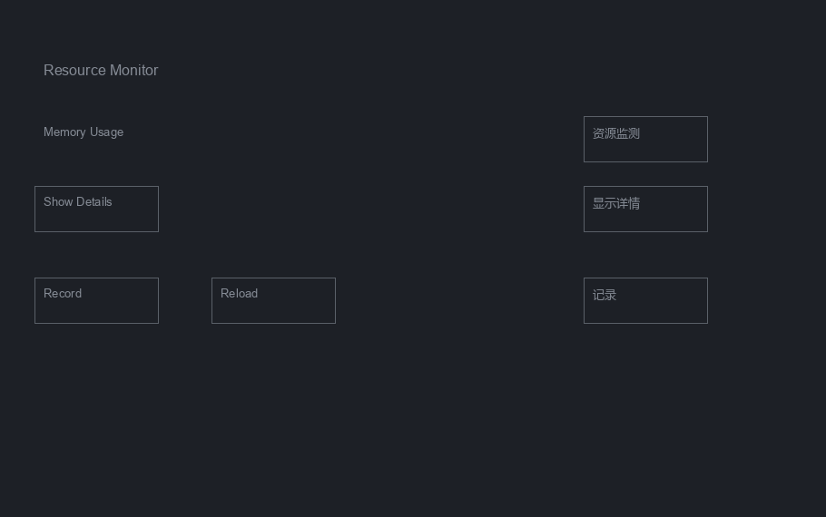

# Week 6 多模态桌面智能体实验报告

系统 v2.0.0  高级功能与鲁棒性优化

2026 年 10 月 26 日  Australia/Sydney

## 1 交付范围与主要结果

本版按项目大纲的 Week 6 四项要求整理工程交付。自动拆解采用整体指令约束下的逐动作在线规划，在专用四阶段窗口完成两组固定目标，其中一组包含真实瞬态审阅拒绝后的恢复。完整CPU回归为3027项通过、0失败，pytest 535.12秒，封装墙钟566.027秒，真实exit 0；244份文件的before、after与当前SHA完全一致。

| 大纲要求 | 本版实现与验证范围 | 证据 |
|---|---|---|
| 自动拆解与分步执行 | 当前画面下一动作规划，输入后重观察，固定调用方目标 | 正常017与瞬态015按原约束完整通过 |
| 错误检测与自动重试 | 新观察重规划，共享额度，未知派发停止 | 真实审阅拒绝恢复及11场景模拟 |
| UI识别准确率与速度 | screen双语OCR与同帧轮廓去重，分开测量代价 | 6帧冻结留出与100组配对计时 |
| 实时监测与日志 | 根终态和子任务逐输入日志，只读检查进程身份 | 两个正向批次原状态与输入回执 |

层次化语义子任务生成与子任务依赖管理未实现。CALLER_GOAL 是本地执行容器，模型根据完整目标生成下一动作，并未生成经验证的语义子任务序列。本周结论适用于受控专用窗口及冻结图像，不能推出任意应用的复杂任务成功率。大纲第三页的 Week 7 综合任务集、跨应用与分辨率评估和竞品对比另行开展。

正常017为ALPHA与GREEN，4个输入、4次规划、4次HTTP，运行652.750秒；瞬态015为BETA与BLUE，5个输入、5次规划、5次HTTP，运行275.703秒。运行器、独立应用终态、逐项输入归因及源码未变均通过。原始失败和早期中断分别保留，不合并计算开发过程成功率。

留出集screen配置识别46/48个标签，精确率、召回率与F1均为95.83%；同双语资源的原始配置识别30/48个。screen整帧处理中位耗时增加9.75%。轮廓去重使固定四图UI提取中位耗时减少15.51%，没有证明整个智能体普遍加速。

开发在 codex/week6-delivery 分支进行。本周不新增训练或消息发送；Week 5 C11权重、原训练、质量结果及资源补测结论独立保留。报告日期为2026年10月26日 Australia/Sydney，原运行时间戳及其显式时区偏移保持不变。

<!-- pagebreak -->

## 2 整体指令约束下的滚动动作规划

CLI 的 --instruction 入口默认采用 rolling_actions。调用方提供整体任务和不可由模型改写的最终 expect_text、forbid_text；模型读取当前截图和候选元素，提出至多一步原生动作计划。执行器按新帧解析当前目标，输入后重新观察。如果调用方目标尚未满足，运行器把失败分类与剩余额度带入下一次规划。

Python AutomaticWorkflowRunner API 默认保留 observed_departure 兼容入口；CLI可用 --automatic-protocol observed_departure 显式选择旧模式。旧流程的marker选择、原模型检查与A派生进展契约只按各自历史版本解释，后续真实正向验收使用滚动动作协议。

当前协议为 week6.rolling_actions.v2。输入前的 rolling_compilation.json 保留完整原请求、CALLER_GOAL本地容器、独立FINAL规则和共享限额，明确 gate_on_step_verification=false。这个设置使模型自写的step expected_result作为诊断预测，保留原始passed、failed与inconclusive。每次规划仍硬限 max_steps=1，结束这一步即由既有TaskRunner重新观察并检查调用方最终规则。

单步上限约束每次计划，整个任务可在预算内多次规划和输入。模型预测未匹配时不会因自造句子挡住已经满足的调用方目标；真正执行失败、未知派发、取消和超时的原早退分支继续有效。未满足调用方规则时继续重规划；容器结束后，还必须使用另一张独立新帧检查同一最终规则。

原 --workflow 入口保留调用方显式定义的1至32个有序阶段，与整体instruction互斥。其逐阶段严格检查保持原行为。滚动路径没有模型生成的层次结构或依赖图，也没有语义已完成阶段台账；固定容器和动作数不能解释成已完成语义子任务数。

模型输出finish、自然语言reason、派发成功或局部step诊断均不能独立证明整体成功。所有原回复、parsed plan、当前画面、解析动作与最终验证分别保存。已有运行目录会被拒绝，旧日志不能触发自动恢复；默认dry-run不改变应用状态，真实CLI执行仍需交互确认。

<!-- pagebreak -->

## 3 失败恢复与运行状态

目标缺失或明确失败后，重规划通过context.recovery获得失败分类、最多五个动作结果、累计和剩余动作数及剩余时间。反馈不携带旧坐标、输入内容或模型原文。运行器重新观察并解析当前目标，避免直接重用旧帧位置。

动作、规划调用、实际HTTP和单调时钟时限全程共享；失败与恢复也消耗额度。OpenAI兼容客户端按httpx实际派发事件计数，关闭SDK隐式重试，请求超时缩至剩余时限，返回过晚的结果会被拒绝。自动入口拒绝无法明确计数的LangChain transport。格式重试与规划调用、HTTP数量分别记录。

派发前写入dispatch_intents.jsonl，意图不证明输入发生。进入执行器后异常退出且无完整ActionResult时，该次记入unconfirmed_action_attempts并停止自动重试。已确认动作数此时只是实际输入数量的下界。派发前观察失败可保持未知次数为0，两种情况在014与016分别保留。

根目录保留原子run_status.json和追加status_events.jsonl，记录整体阶段与真实终态；逐输入动作、规划和恢复细节主要在workflow/001_CALLER_GOAL子目录。根状态未必逐步更新，不能用根动作0解释子任务没有输入。状态记录包含PID、进程身份、限额和经过时间，不保存任务正文、输入或坐标。

scripts/week6_status.py只使用标准库，只读核对快照、事件序列及进程身份。缺失、损坏、过期、进程消失、PID复用或暂不可读分别诊断。finished表示终态记录可信，成功与否仍须读取task_status。长模型调用没有新阶段事件时，过期状态不能被解释为进程退出。

模型返回、监测及意图写入后继续检查时限与前台身份。未知派发后不重放，不完整计数不得作为完整验收；取消摘要只读取有效步骤和恢复记录，损坏行注明，原日志保留。正常017和瞬态015均保留可信active与succeeded终态，以及独立真实owner退出收据。

<!-- pagebreak -->

## 4 感知优化与冻结实验

候选框优化只处理当前帧。代码合并重复边框、缓存同帧几何量，先做面积筛选再计算交集，并保留原边缘检测、OCR 排除、候选预算与排序规则。此前四张 960×640 合成图的 100 组交替顺序配对中，有序候选的坐标、中心、来源和置信度完全一致。

该组 UI 提取中位耗时由 14.421 降至 12.185 ms，减少 15.51%。浅色、深色、密集与细边框图分别为 8.569→8.417、8.003→8.220、22.238→16.912、22.631→16.150 ms；深色图略慢。顺序测得的热观察总时间为 221.848→228.817 ms，增加 3.14%，不支持整帧普遍加速结论。

新增准确率实验在优化前冻结 12 张合成图、96 个可见标签、72 个矩形控件、字体和图片哈希。开发集与留出集各六图，文字、布局、尺寸及视口不同。方法在开发集选择后冻结，再进行一次正式留出评价；生产 OCR 不接收标注、期待文字或图片名称。

screen 配置在单次当前帧 OCR 中做深色背景归一化、全局对比度拉伸、长横竖边框抑制、2 倍 Lanczos 放大，使用 Tesseract PSM 11/OEM 1；随后连接同一行的中日韩字符间空白，并把坐标向外取整、映射和裁切到原图。轮廓提取继续使用原图，不缓存旧帧位置。

三个对照组分别为原始英文、相同英中语言资源的原始配置、相同资源的 screen 配置。这样可以区分增加中文资源和算法处理的影响。文字按常规空白归一化后完全匹配，且一对一框匹配 IoU≥0.5；未匹配输出计为误检。矩形控件另用一对一 IoU≥0.8。

<!-- pagebreak -->

## 5 留出准确率与处理代价

| 留出配置 | TP FP FN | 精确率 | 召回率与 F1 | 整帧中位 ms |
|---|---|---|---|---|
| 原始英文 | 28  4  20 | 87.50% | 58.33%  70.00% | 199.343 |
| 原始英中双语 | 30  11  18 | 73.17% | 62.50%  67.42% | 342.302 |
| screen 英中双语 | 46  2  2 | 95.83% | 95.83%  95.83% | 375.676 |

准确率每张图只计一次，共 48 个留出标签。每配置每图运行三次、交替顺序，54 份结果全部保留，重复结果一致；这些重复标签不能当成 144 个独立样本。时延采用全部重复记录的中位数，范围是 PNG 解码、真实 CPU OCR 和候选提取，不含操作系统截屏、模型规划或动作执行。

screen 配置英文为 30/30，中文为 16/18。相较同双语资源原始配置，召回率增加 33.33 个百分点，处理中位耗时增加 9.75%；相较原始英文配置，召回率增加 37.50 个百分点，耗时增加 88.46%。三个配置都找出 36/36 个矩形控件，多余轮廓分别为 21、9、2；该指标仅覆盖本实验完整标注的矩形控件。

三组整帧最近秩 p95 分别为 273.393、372.819、420.675 ms，每组 n=18，是六张图各三次的相关重复。该统计包含全部重复，没有排除慢记录；因样本少且相关，不能解释为桌面任务时延分布。

开发记录也保留：001、002 批次在路径处理阶段失败，未完成 OCR 对比；003 批次仅放大后，screen 识别 33/48、精确率 70.21%；004 加入通用边框抑制后识别 44/48、精确率 93.62%，据此冻结。留出评价后未按失败标签调参。实验没有导入 GPU 框架或训练模型。

<!-- pagebreak -->

## 6 真实截图验证与识别限制

冻结参数后另取一张实际专用窗口截图，先手工视觉标注中心区域的五个英文标签及两个按钮，再对完整 2560×1600 图片运行三个配置、每组重复三次。标注区域只用于计分，不裁切 OCR 输入；源码、图片、标注及探测脚本前后哈希一致。

| 实际截图配置 | 区域标签 | 区域按钮 | 整帧中位 ms |
|---|---|---|---|
| 原始英文 | 5/5  无误报 | 2/2 | 428.466 |
| 原始英中双语 | 5/5  无误报 | 2/2 | 577.626 |
| screen 英中双语 | 5/5  无误报 | 2/2 | 836.893 |

这张简单英文画面没有准确率增益，screen 处理成本更高。区域外的其他 UI 未完整标注，整帧精确率保留为缺失值。该源运行另有未解释的外部输入事件，不能作为智能体执行成功证据；本实验只评价保存的像素，不运行模型或桌面动作。



图 1  合成留出图中的资源监测和显示详情仍未准确识别  三次错误均保留

真实截图只有一个独立画面、五个标签，不能证明真实桌面分布上的准确率提升。合成留出集的两个中文错误也没有按期待标签修正。默认 native 配置继续保留，screen 由调用方显式选择。

<!-- pagebreak -->

## 7 确定故障下的运行行为

故障演示真实调用 `WorkflowRunner`、`TaskRunner`、`ActionAdapter`、`Verifier` 和 `TaskRecorder`。观察、规划、执行与时钟由确定状态机代替，执行器只改内存，不调用 OCR、模型或桌面。最终第五批 11/11 场景、218/218 行为核对通过，墙钟 10.569 秒。失败或阻止终态符合预期时，也计为行为核对通过。

| 场景 | 整体状态 | 确认调用 | 未确认 | 规划 | 恢复 |
|---|---|---|---|---|---|
| 无故障三子目标 | succeeded | 3 | 0 | 3 | 0 |
| 第二目标短暂缺失 | succeeded | 3 | 0 | 4 | 1 |
| 一次明确执行失败 | succeeded | 4 | 0 | 4 | 1 |
| 持续失败至规划上限 | failed | 3 | 0 | 3 | 1 |
| 共享动作额度耗尽 | blocked | 2 | 0 | 2 | 0 |
| 返回时总时限耗尽 | timed_out | 1 | 0 | 1 | 0 |
| 第二阶段规划中取消 | cancelled | 1 | 0 | 2 | 0 |
| 子目标全过而总体未过 | failed | 3 | 0 | 3 | 0 |
| dry-run | dry_run_completed | 3 | 0 | 3 | 0 |
| 消息工作流 | rejected | 0 | 0 | 0 | 0 |
| 执行结果未知 | failed | 1 | 1 | 2 | 0 |

已确认调用沿用生产 `action_count`，包括取得完整结果的失败调用及 dry-run 校验，并不等于成功执行数。未知执行场景中，执行器改变状态后抛出异常，已确认数为 1、未确认数为 1，`accounting_complete=false`，没有继续重放。

目标移动场景对照派发当时的帧，恢复使用新位置，第一子目标仅执行一次。所有场景保留轨迹、子任务日志、恢复记录、检查点、期望与实际值及源码快照；源码前后哈希一致。已有目录拒绝检查没有改变原批次字节。模拟结果用于解释运行机制，真实窗口结果另列。

<!-- pagebreak -->

## 8 真实窗口验收方法与结果

验收使用专用离线Tk窗口、整体自然语言指令和调用方最终文字规则。模型读取真实截图、CPU Tesseract文字和当前帧候选；独立应用状态及事件文件仅供验收对照，不作为模型输入。任务要求先选项目、再选主题、审阅、提交，最终同时显示正确项目、主题和LOCAL COMPLETE。

生产规划器、动作适配器、TaskRunner、WorkflowRunner与验证器按真实模型回复运行。输入经Sky桥接，保留生产适配器解析的坐标，并在派发前重新观察、限定专用窗口，只接受单击或双击。桥接的逐次起止和返回结果用于归因；该实验没有通过stock PyAutoGUI执行器派发，不能替代其任意应用验证。

| 新源码实际批次 | 目标及条件 | HTTP 规划 输入 | 运行秒 | 严格整体结果 |
|---|---|---|---|---|
| 正常017 10月26日 | ALPHA GREEN | 4 4 4 | 652.750 | succeeded 全部核验通过 |
| 瞬态015 10月25日 | BETA BLUE 首次审阅拒绝 | 5 5 5 | 275.703 | succeeded 全部核验通过 |

两批均为qwen2.5vl:7b、本机Ollama端点，温度0、max_tokens 2200、transport重试0；限额均为12次动作、12次规划、24次HTTP及1200秒。源码SHA为706d98f6156f01224c3fcb99b971623553f91e732249818c029b46665efd6940，90份生产与实验源码在各批次前后未变。真实owner子进程均exit 0，未知派发0，accounting_complete=true，completion_basis=executed_caller_goal。

正常四次语义转换分别唯一对应input_001至004。瞬态保留review_rejected后重新观察、重新规划及review_accepted，五次语义事件分别对应input_001至005。不同语义转换不能共用一个双击回执；应用中的400 ms跨页防重入属于实验环境修复，不计模型质量提升。

瞬态拒绝来自应用审阅层，两批所有ActionResult均success、已知执行器失败数均为0；真实恢复证明UI拒绝后的新观察重规划，执行器失败分支另由CPU场景验证。

正常原step诊断4 passed。瞬态为4 passed、1 failed：提交后的画面没有模型写的Commit locally action completed，原failed保持不变；调用方规则与独立final仍通过。审阅被拒那一步也因宽松词匹配记为passed，所以局部step诊断不等于语义成功。所有原回复、检查、失败及最终判据可分别追溯。

耗时包含模型、截屏、OCR、激活与桥接等待，不能称纯GPU计算或无人值守稳态时延。两组固定目标不足以形成一般任务成功率，也未比较3b与7b模型优劣。

<!-- pagebreak -->

## 9 真实窗口开发记录

初始qwen2.5vl:3b Q4_K_M另在三张保存合成图上进行3次规划、5次HTTP：两个唯一目标对照正确，双同名按钮猜选左侧；三个最终计划均省略提示要求的finish，两个条件首次状态字段触发格式重试。它没有OCR或桌面执行，不是任务成功率。

正式验收前的 001 至 007 批次分别暴露了输出长度、桥接能力、前台条件及输入归因问题。独立只读审计保留原记录与哈希，核对 636 份原始文件并另存 160 份结构化副本，输入和副本在审计前后未变。审计不运行推理或桌面输入。这些开发记录没有形成可比较的完整任务评分集，不计算合并成功率。

| 批次 | 原始可观察事实 | 处理与归类 |
|---|---|---|
| 001 | 3b 规划回复达到 2200 token 截断，无输入 | 输出失败，整体 blocked |
| 002 | 7b 请求双击，最初只支持单击的桥接返回 5 次完整拒绝 | 桥接能力不匹配，人工停止 |
| 003 | 应用发生 4 次阶段转换，却没有 Sky 输入回执 | 外部输入归因异常，不计完成 |
| 004 | 专用窗口不是稳定前台，动作数 0 | 安全前置检查 blocked |
| 005 | 约 90 秒未获窗口激活回执，模型调用 0 | 激活超时，整体 failed |
| 006 | 回执明确报告专用窗口不存在，模型调用 0 | 恢复后的环境缺失，failed |
| 007 | 一次双击触发项目和主题两次转换，相隔 149.975 ms | 跨页误触风险，停止且未确认完成 |

002 的原操作说明退出码保留为未知，外层 shell 后续另观测到 exit 1；两者来源不同，不回填原记录。该说明在当时记下三次拒绝，完整步骤日志则保留五次拒绝，两份证据均保留。005 的 Esc 原因来自当时操作说明，原始日志直接证明的是激活超时，不单凭日志推断按键。

007 只有一个成功输入回执，却产生两个语义转换，不能证明模型分别规划并执行了两阶段。后续专用窗口增加 400 ms 跨页防重入；验收要求每个语义转换分别对应不同输入回执。此项修复属于实验环境，不能计作模型识别或规划质量提升。

多轮自动工作流也移除了冗余父级监测，避免局部工作流计数重置误导根进度。真实状态及原始步骤继续保留，正式验收另用新目录。审计依据为 `live_development_audit_20261024/summary.json`，源运行中缺少的摘要和退出码保持未知。

<!-- pagebreak -->

## 10 后续失败与保存图诊断

008以后各尝试按独立目录保留。下表区分模型输出、进程停止、环境等待和未归因的应用终态；实际owner退出码不替代运行器完成判定。

| 批次 | 计数与原始结果 | 解释 |
|---|---|---|
| 正常008 | 2输入 6HTTP 776.391秒 failed | 两阶段归因通过，后续激活超时 |
| 正常009 | 2输入 7HTTP 276.563秒 failed | 第三轮三次提案检查已满足，未审阅 |
| 正常010及011 | 各0输入 1HTTP 34.391与38.422秒 | needs_clarification，非用户缺信息结论 |
| 正常012 旧源v1 | 4输入 4HTTP 253.657秒通过 | 仅旧源历史成功，不替代v2验收 |
| 瞬态013 | 6已知输入 7HTTP 真实exit15 | 受控停止，无完整运行验收 |
| 正常014 | 2已知输入 1未知 3HTTP failed | 桥接请求到期，无完整第三回执 |
| 正常016 | 3输入 0未知 4HTTP 397.781秒failed | 提交无输入归因，随后激活超时 |

013的应用已经到达完成画面，但模型提交预测句子未出现，原step failed后又提出完成标签动作。六次输入有完整结果，第七计划已保存而无后续回执；核验实际PID及创建时间后受控停止。原child摘要只包含第六轮的临时计数，native与transport记录为七次，single-step恢复未完成；不补写acceptance或成功退出码。

014原运行器在第三次执行器调用后无完整结果，记1个unconfirmed，禁止自动重放；操作记录另报告桥接Expired input。016的独立应用终态通过，但local_commit事件不在三个保存输入回执区间内，来源未知。第四个Commit locally计划在派发前因激活回执缺失而停止，ActionResult为空，后续重规划同样未启动。不能推断额外智能体输入、自动提交或外部操作者。

保存图诊断也完整保留。旧生产分解3次、显式多轮2次、字段语义2次、新合取版本1次与schema示例1次，共9次HTTP；旧字段组合存在合取误拦，后两次结构允许仍有后态可实现性疑点。之后另有8个明确命名的单请求归档探针：三个schema探针、一个动作规划、一次原请求无图对照及三次goal-blind marker诊断。ready、局部正确ALPHA计划和模型reason均没有被计作桌面成功。

这些保存图探针均无新截屏、输入或任务执行；不同方案及失败条件不合并计算成功率。旧marker路径未证明稳定产生可执行语义阶段，当前正向证据只支持整体指令下的滚动动作规划。当前参数没有按留出标签或失败应用日志回填识别结果。

<!-- pagebreak -->

## 11 回归验证与历史保留

最新完整回归选取 results/release_validation_completed_20261026_006/validation.json。完整CPU回归为3027项通过、0失败，pytest 535.12秒，封装墙钟566.027秒，真实exit 0；244份文件的before、after与当前SHA完全一致。最终tested_source_pins_before、after和当前文件须完全一致，原stdout、真实退出码、封装墙钟和Ruff结果分别保留，不把收集数拼成通过数。

| 完整检查批次 | 通过 | 失败 | pytest秒 | 退出码 |
|---|---|---|---|---|
| 第一阶段历史检查 | 2667 | 6 | 587.29 | 1 |
| 10月24日首轮 | 2812 | 16 | 470.14 | 1 |
| 第二批 | 2837 | 0 | 439.53 | 0 |
| 第三批 | 2840 | 0 | 437.19 | 0 |
| 原交付第四批 | 2840 | 0 | 443.05 | 0 |
| 完善第一批 | 2916 | 1 | 437.36 | 1 |
| 完善第二批 | 2917 | 0 | 585.67 | 0 |
| 完善第三批 | 2917 | 0 | 606.57 | 0 |
| full004历史 | 2924 | 0 | 485.59 | 0 |
| full005历史 | 2927 | 0 | 428.96 | 0 |
| 当前full006 | 3027 | 0 | 535.12 | 0 |

第一阶段六项编码失败在UTF-8修复后仅复测六项，6通过、7.67秒，当时没有一次全量通过。本轮最早16项失败涉及监测初始化、计时兼容、前台计数、版本断言与Windows文件替换。267项定向检查曾266通过、1失败；监测51项2.66秒及OCR141项4.01秒分别保留，不拼接为全量结果。

完善第一批唯一失败是README仍写2840而收集2917。第二批虽全部通过、封装591.059秒，但两份实验脚本变化，tested_sources_unchanged=false；src、tests、configs、pyproject未变。第三批封装612.299秒、源码未变；full004封装488.844秒，full005封装431.515秒，均作为旧阶段，不替代新v2。

滚动v2的191项针对检查、23项独立CPU反例及3027项collect-only均有对应原件，前两者只说明局部验证，收集检查不代表执行通过。完整回归只能引用本轮实际新源码结果。原full004/full005待完成稿、旧DOCX、PDF和先前源码包保留，各历史日期的结论不覆盖。

<!-- pagebreak -->

## 12 复现入口与证据

在仓库根目录先验证整体请求及调用方最终规则，该步骤不调用模型或桌面：

```powershell
python scripts/week6_agent_cli.py --instruction "Complete the local task" --expect-text "Expected final marker" --validate-only
```

默认CLI整体入口为rolling_actions，Python API默认observed_departure。固定有序工作流仍用--workflow。默认dry-run会观察并调用模型，真实执行添加--execute后仍需交互终端逐计划确认，没有--yes。screen双语OCR须显式选择configs/week6_accuracy.yaml，并按 [Week6使用说明](README.md) 设置本机语言资源。

逐输入状态读取子目录；根目录用于整体生命周期和终态。完整检查命令：

```powershell
python -S scripts/week6_status.py --run-dir outputs/week6/your_run_id/workflow/001_CALLER_GOAL
$env:PYTHONUTF8 = "1"
$env:PYTHONIOENCODING = "utf-8"
python -m pytest -q
python -m ruff check src tests scripts
```

感知配对数据见 [原感知实测](results/perception_report.md)，冻结准确率见 [留出实验说明](results/perception_accuracy_20261024/README.md)。真实像素数据为perception_accuracy_live_20261024/external_001/summary.json；模拟为robustness_20261024_attempt005/summary.json，早期模型为model_recovery_20261024_001/。

真实正向原件为live_auto_20261026_normal_017/acceptance.json及live_auto_20261025_transient_015/acceptance.json。每批保留rolling_request/compilation、原生计划、HTTP事件、前后截图、步骤、原step诊断、独立final、应用事件及owner退出收据。各类历史开发失败在原目录保留；001至007的审计见live_development_audit_20261024/summary.json。

最终回归来源固定为release_validation_completed_20261026_006/validation.json。交付检查覆盖同一completion原字节、最终页图、数字与链接，以及源码、wheel和打包字节；结果由随包校验清单记录。本版按上述受限工程范围闭合实现与证据；报告和分发文件按独立生成与发布清单核验。

当前结论仅覆盖上述工程范围。层次化语义子任务、依赖管理和任意应用成功率未实现或未测；跨应用、分辨率及竞品比较属于Week 7。screen识别效果与处理代价分别报告，不承诺整个智能体更快。本机离线实验不新增消息发送。

