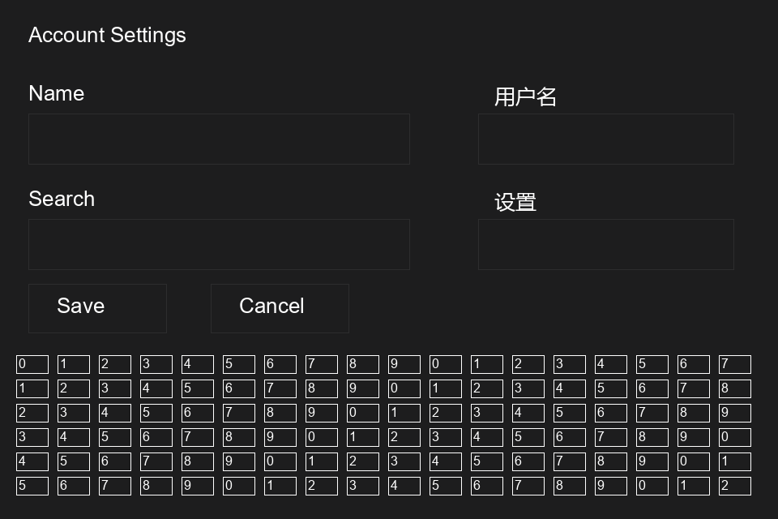
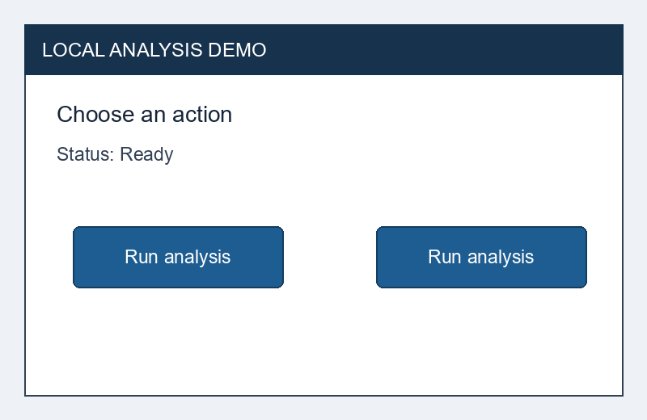

# Week 6 多模态桌面智能体实验报告

系统 v2.0.0  高级功能与鲁棒性优化

2026 年 10 月 24 日  Australia/Sydney

## 1 本周结果与验证范围

本周为桌面智能体增加了有序子目标执行、失败反馈与恢复、当前帧感知优化和运行状态监测。系统版本为 2.0.0，开发分支为 `codex/week6-delivery`。验证结果支持这些运行机制在已测条件下按预期工作；真实应用中的复杂任务完成率仍未测量。

故障演示使用生产运行器与模拟后端，11 个场景的 218 项预期行为核对全部通过。感知测量运行真实 CPU OCR，并比较同一批合成截图上的候选提取，100 组配对的 UI 提取中位耗时由 14.421 降至 12.185 ms。真实本地模型探测保留了负例：三个固定条件中两个目标对照通过，同名按钮条件发生猜选，三个最终计划都省略了提示要求的 `finish`。

| 证据层级 | 实际运行内容 | 可支持的结论 |
|---|---|---|
| CPU 回归与故障演示 | 生产运行逻辑及确定模拟后端 | 检查预算、恢复、终止和记录行为 |
| 感知实测 | 合成图上的 Tesseract 与 OpenCV | 当前固定图的耗时及候选一致性 |
| 真实模型探测 | 本地模型读取保存的合成图 | 三个固定条件的规划与目标解析 |
| 真实桌面任务 | 本轮未执行 GUI 动作 | 尚无本周真实桌面成功率 |

本轮从第一阶段提交 `9149e064d90ab6796e7f25ece6cbbd026785b26c` 继续；其父提交为 Week 5 正式提交 `d180710d7efcfdd6930065cdba6abf882a52328f`。Week 5 的 C11 权重、训练、资源补测和历史质量结论独立保留。本次真实模型探测使用 Ollama 已安装基础模型，没有加载或修改 C11 LoRA。

<!-- pagebreak -->

## 2 子目标执行与总体目标检查

`WorkflowSpec` 由调用方提供最多 32 个有序子目标，实现在 `src/gui_agent/runtime/workflow.py`。每个子目标都必须有非空的 `expect_text` 或 `forbid_text`，仍由原 `TaskRunner` 完成观察、规划、目标解析、执行与验证。自然语言成功描述不会自动成为可信验收规则，模型说完成或动作返回成功也不能单独完成子目标。

工作流只在当前子目标的实际检查通过后进入下一阶段。动作额度、规划调用次数和单调时钟时限在各阶段之间共享，恢复尝试也消耗剩余额度。失败、取消、超时、未知执行结果或预算耗尽会停止后续阶段；已验证的阶段保留，不从头重放。

全部子目标通过后，系统再获取一个新观察，用独立 `final_check` 检查总体目标。观察和证据保存结束后再次核验时限，若预算已耗尽则返回超时，不继续调用验证器。模拟负例中，三个子目标均通过，但新的总体观察缺少必要标记，整体仍返回 `failed`。这个检查避免把局部步骤完成直接当作整体完成。

默认 dry-run 只检查计划，不改变应用状态。模拟演示中虽然有三次已确认的校验调用，完成子目标数仍为 0，状态为 `dry_run_completed`。真实执行要求交互终端及逐阶段展示和确认；CLI 没有跳过确认的 `--yes` 选项。

定义检查入口为 `scripts/week6_agent_cli.py --validate-only`，只解析配置，不加载模型、不捕获屏幕、不创建运行目录。示例配置在 `configs/week6_example_workflow.json`，配套页面在 `Document/Week6/demo/local_editor.html`。页面只保存内存状态，示例未被记为已完成的真实桌面任务。

本版总体检查支持显式文字规则，不支持进程退出规则。工作流拒绝消息任务，原单任务的发送前后检查和发送后禁止重试继续保留，本周没有新增消息发送额度。工作流根目录必须新建，已有日志无论完整或损坏都不能触发自动恢复执行。

<!-- pagebreak -->

## 3 恢复记录与运行监测

恢复逻辑位于 `src/gui_agent/runtime/recovery.py` 和同目录的 `runner.py`。失败后，规划器通过 `context.recovery` 收到最近一轮失败分类、最多五个动作结果、累计与剩余动作数及剩余时间。反馈不携带旧坐标、输入文字、模型原文或自由文本错误。恢复基于当前观察重新解析目标，并继续受原共享预算约束。

目标短暂缺失的演示中，动作前当前帧已没有目标，真实解析器拒绝派发；下一帧目标移动后，恢复使用新位置。第一子目标只执行一次。一次明确执行失败的场景则保留失败的完整 `ActionResult`，后续恢复成功，四次已确认调用中仍有一次失败。完整失败结果也可能伴随局部副作用，恢复仍须重新观察，不能据失败状态认定界面未变。

进入执行器前，`dispatch_intents.jsonl` 写入不含输入内容的派发意图。如果执行器已改变状态，却在返回完整结果前抛出异常，系统将这次调用计入 `unconfirmed_action_attempts`，停止自动重规划和重放。演示中已确认调用为 1、未确认调用为 1，`accounting_complete=false`；此时已确认数只是实际执行数量的下界。CLI 根监测终态的已用动作数包含这两类调用，并以 `unconfirmed_dispatch` 标记未知结果，状态读取工具也显示该标记。

`src/gui_agent/runtime/monitoring.py` 为每个任务及工作流根目录写入 `run_status.json` 和 `status_events.jsonl`。前者原子替换，后者顺序追加；记录阶段、子目标、已验证数、额度、相对耗时、进程身份与真实终态，不保存任务正文、输入或坐标。监测和意图写入之后再次检查时限及必要的前台身份，防止记录开销跨过最后检查。

状态读取入口 `scripts/week6_status.py` 只依赖标准库，不启动模型或桌面。它核对快照与日志的序列及内容，并区分损坏、缺失、超过 30 秒未更新、进程消失和 PID 复用。`finished` 表示终态记录可信，是否成功仍须读取 `task_status`。阶段更新不能独立证明一次长模型调用仍在推进。

取消摘要从步骤和恢复日志的完整有效记录重建，损坏行会注明，原始字节保留。工作流检查点回调在持久化后读取当时进度，但当前不接收 `finally` 写入的最后终态事件，最终结果应查终态检查点和 `workflow_summary.json`。

<!-- pagebreak -->

## 4 感知优化方法与测量口径

感知入口为 `src/gui_agent/perception/ui_detection.py` 和 `src/gui_agent/runtime/observation.py`。基线固定为第一阶段提交的观察服务与轮廓检测代码，先测基线，再修改代码。密集细边框图的三次 cProfile 共计 0.134 秒，其中 `_deduplicate` 累计 0.087 秒，提示重复的包含关系计算占用了主要 Python 时间。这组剖析数据用于定位热点，速度结论采用未剖析的配对计时。

优化仅作用于当前帧：相同坐标的边框只进入后处理一次，框面积及坐标只提取一次，先检查面积条件再计算交集，轮廓集合改用迭代器连接。两个边缘检测分支、细边框 0.90 矩形度门槛、OCR 排除规则、优先区域和候选预算保留，未缓存上一帧目标。

本次使用四张 960×640 合成图，覆盖浅色、深色、密集控件与低对比度一像素边框。每图含五个英文标签、两个中文标签和六个已知矩形控件；密集图另有未完整标注的小控件。基线和新版各做每图五次观察，候选提取另做每图 25 组交替顺序配对，共 100 组。



图 1  固定合成输入示例  图片由脚本生成

真实 OCR 为 Tesseract 5.5.3.20260724 CPU，语言配置为 en，最低置信度 0.5。UI 独立计时使用同帧真实 OCR 排除框，排除图片解码，基准进程内 OpenCV 线程数为 1。`capture` 在本实验中是 PNG 解码，不能解释为操作系统截屏耗时。

<!-- pagebreak -->

## 5 感知结果与语言限制

| 合成图 | 基线中位 ms | 新版中位 ms | 耗时变化 | 候选数 |
|---|---:|---:|---|---:|
| 浅色表单 | 8.569 | 8.417 | 减少 1.77% | 14 |
| 深色表单 | 8.003 | 8.220 | 增加 2.71% | 13 |
| 密集控件 | 22.238 | 16.912 | 减少 23.95% | 122 |
| 细边框 | 22.631 | 16.150 | 减少 28.64% | 118 |
| 合计 100 组 | 14.421 | 12.185 | 减少 15.51% | 逐项一致 |

100 组配对中的有序候选列表完全一致，包括顺序、坐标、中心、来源和置信度。四图 24 个已知矩形均有 IoU≥0.8 的候选，基线与新版相同；其他候选未全部标注，因此不能从这组数据计算候选精确率。

按每图首次观察的已知标签计，英文为 20/20，中文为 0/8，五次重复结果一致。判定要求对应标注区域内的规范化文字完全相同。本机 Tesseract 只有 eng 和 osd 数据，中文失败原样计入，当前配置不能据此声称支持中文。

热观察总时间跨时段顺序测得 221.848→228.817 ms，增加 3.14%，未证明端到端加速。OCR 占主要耗时，轮廓优化对简单深色界面也稍慢。两个版本首次观察分别为 515.544 和 281.452 ms，首次导入及系统缓存条件不同，不能作为初始化提速证据。

`ObservationSnapshot.stage_timings_ms` 增加 capture、engine_init、ocr、ui_detection 和 selection 五段非重叠墙钟时间。OCR 引擎在同一服务内复用，后端首次识别的延迟加载计入 ocr；旧记录缺少该字段时仍可读取。计时不改变错误结果，未调用的阶段记 0 不表示成功。

专项 95 项回归均通过，用时 2.75 秒。测试覆盖旧快照兼容、阶段失败、连续帧不复用坐标和候选等价性。上述标签、矩形及耗时结果均属于固定合成图测量，不能替代真实应用的任务完成验证。

<!-- pagebreak -->

## 6 确定故障下的运行结果

演示真实调用 `WorkflowRunner`、`TaskRunner`、`ActionAdapter`、`Verifier` 和 `TaskRecorder`。观察、规划、执行后端与时钟由确定状态机替代；执行器只改内存状态，不调用 OCR、模型、GUI 或消息。最终批次的 11/11 场景、218/218 核对项通过，运行墙钟约 10.569 秒，虚拟耗时只用于触发 deadline。

| 场景 | 整体状态 | 确认调用 | 未确认 | 规划 | 恢复 |
|---|---|---:|---:|---:|---:|
| 无故障三子目标 | succeeded | 3 | 0 | 3 | 0 |
| 第二目标短暂缺失 | succeeded | 3 | 0 | 4 | 1 |
| 一次明确执行失败 | succeeded | 4 | 0 | 4 | 1 |
| 持续失败至规划上限 | failed | 3 | 0 | 3 | 1 |
| 共享动作额度耗尽 | blocked | 2 | 0 | 2 | 0 |
| 执行返回时总时限耗尽 | timed_out | 1 | 0 | 1 | 0 |
| 第二子目标规划中取消 | cancelled | 1 | 0 | 2 | 0 |
| 子目标全过而总体未过 | failed | 3 | 0 | 3 | 0 |
| dry-run | dry_run_completed | 3 | 0 | 3 | 0 |
| 消息工作流 | rejected | 0 | 0 | 0 | 0 |
| 执行结果未知 | failed | 1 | 1 | 2 | 0 |

已确认调用沿用生产 `action_count`，表示取得完整 `ActionResult` 的调用，包含明确失败及 dry-run 校验，并不等于成功执行的实际动作数。表中多项任务以失败或阻止结束，恰好符合场景的预期；11/11 表示这些行为核对通过。

每次派发坐标均对照当时的模拟帧，已解析 ID 必须存在于该派发帧。后续子目标在失败、预算耗尽或取消后保持未开始。所有场景分别保留轨迹、真实子任务日志、恢复记录、检查点和逐项期望/实际结果；源文件前后哈希一致。

初次批次与最终批次分别保留。已有输出目录会被拒绝，拒绝后原批次文件字节未变。故障模拟验证运行机制在这些确定条件下的行为，未提供真实桌面或真实模型成功率。

<!-- pagebreak -->

## 7 真实本地模型的规划探测

2026 年 10 月 24 日 UTC 04:11（Sydney 15:11），项目客户端、`TaskPlanner` 与 `ActionAdapter` 对保存的合成界面做真实模型规划和当前帧目标解析。固定本地 `qwen2.5vl:3b`（Q4_K_M），temperature 0、max_tokens 2048、网络请求重试 0；每条件只调用一次规划器，保留原有最多一次格式重试。

| 预先固定条件 | 请求数 | 规划经过 ms | 目标对照 |
|---|---:|---:|---|
| 唯一 Run analysis 按钮 | 1 | 17,284.296 | 通过  当前 ID |
| 失败反馈后按钮移动 | 2 | 3,018.992 | 通过  当前唯一文字 |
| 两个同名按钮 | 2 | 2,707.094 | 失败  选择左侧 |



图 2  歧义条件中模型选择左侧按钮  未派发桌面动作

合计 3 次规划调用、5 次推理 HTTP 请求。恢复及歧义条件的首个回复使用 schema 不接受的 `status="success"`，解析器拒绝后进行格式重试。恢复后的回复以当前唯一文字解析目标，未复用旧坐标；三个最终计划都省略了提示要求的 `finish`。两个目标对照通过不能代表完整协议遵循率。

歧义条件说明有效的当前 element_id 只证明候选存在，不能证明模型消除了语义歧义。图片元素来自手工标注，未运行 OCR；恢复反馈由脚本注入，未先执行真实失败。时间包含客户端初始化、格式重试和服务器当时状态，不能称纯 GPU 时间或稳态延迟。本轮未运行桌面执行器，也没有执行后成功验证。

<!-- pagebreak -->

## 8 验证记录与复现

最终第四批完整检查为 2840 通过、0 失败，pytest 用时 443.05 秒，运行封装总用时 445.544 秒；命令退出码为 0，测试源码前后未变。此批次包含最终观察时限、未知派发监测和并发读取测试的修正，作为本版完整回归记录。

| 检查批次 | 通过 | 失败 | pytest 秒 | 退出码 |
|---|---:|---:|---:|---:|
| 第一阶段完整检查 | 2667 | 6 | 587.29 | 1 |
| 10 月 24 日首轮 | 2812 | 16 | 470.14 | 1 |
| 第二批完整检查 | 2837 | 0 | 439.53 | 0 |
| 第三批完整检查 | 2840 | 0 | 437.19 | 0 |
| 最终第四批完整检查 | 2840 | 0 | 443.05 | 0 |

第一阶段六项编码失败统一 UTF-8 后仅复测这六项，6 通过、7.67 秒，当时没有一次全部通过的完整运行。本轮首轮失败涉及监测接入后的初始化、计时与状态兼容、前台检查计数、旧版本断言及 Windows 并发文件替换，原记录保留。

另一次 267 项定向检查为 266 通过、1 失败：并发读取测试遗漏了 Windows 共享拒绝时合法的 unavailable 诊断分支。修正测试断言并补充确定性拒绝注入后，监测 51 项通过、2.66 秒；该修正未改生产代码。全局 Ruff 检查通过。各批次分别保存，不以零散复测拼接完整通过结论。

复现使用项目依赖，并设置 `PYTHONUTF8=1`、`PYTHONIOENCODING=utf-8`。配置验证、状态读取及三个实验脚本的命令与依赖见 `Document/Week6/README.md`；选择新输出目录以保留历史。完整 CPU 检查入口为：

```powershell
python -m pytest -q
python -m ruff check .
```

证据均在 `Document/Week6/results/`：感知见 `perception_summary.json`；故障见 `robustness_20261024_attempt005/summary.json`；模型输入与五次原始回复见 `model_recovery_20261024_001/`；最终完整 CPU 记录为 `release_validation_20261024_attempt004/validation.json`。旧批次保持独立。
